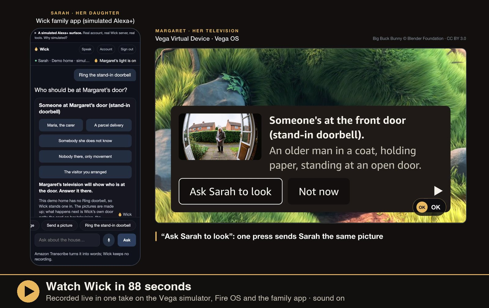
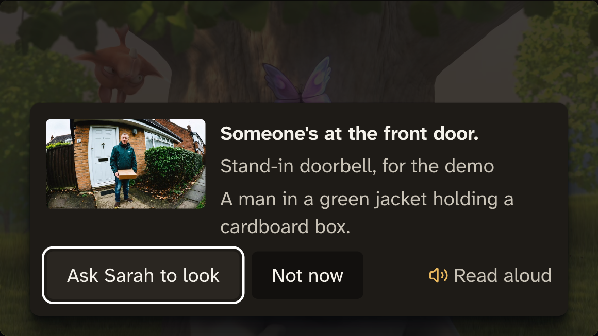
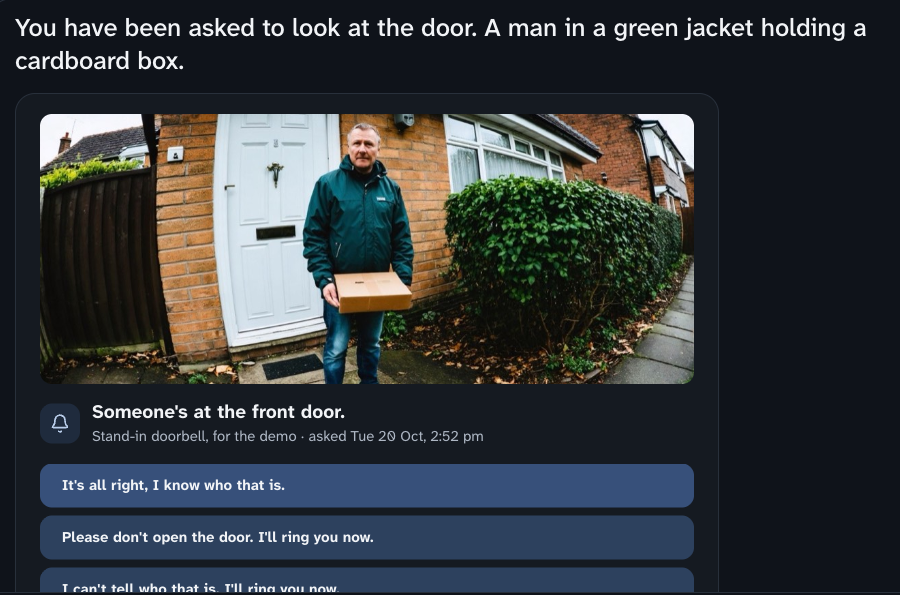
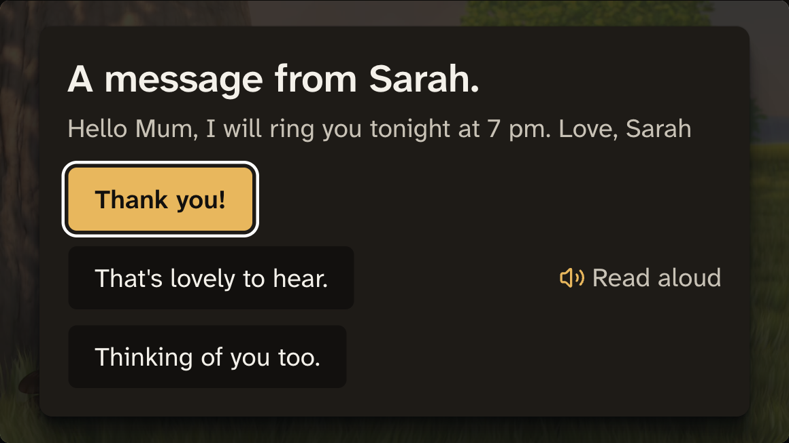
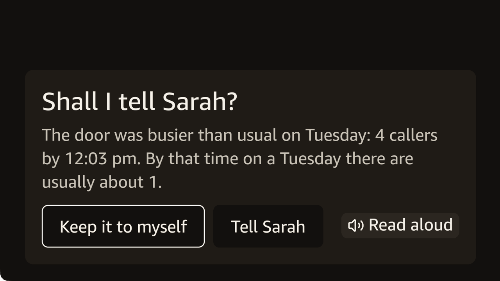
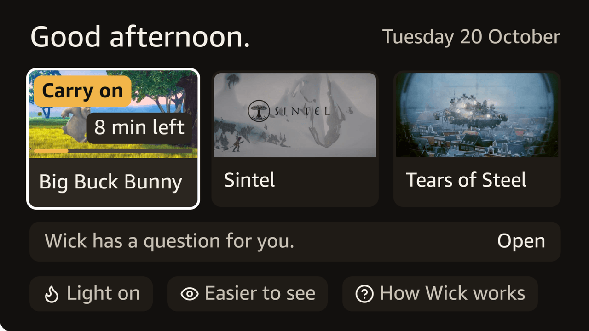
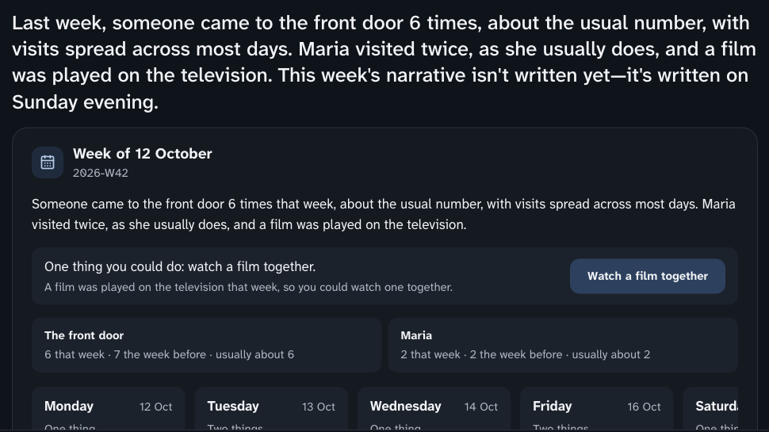
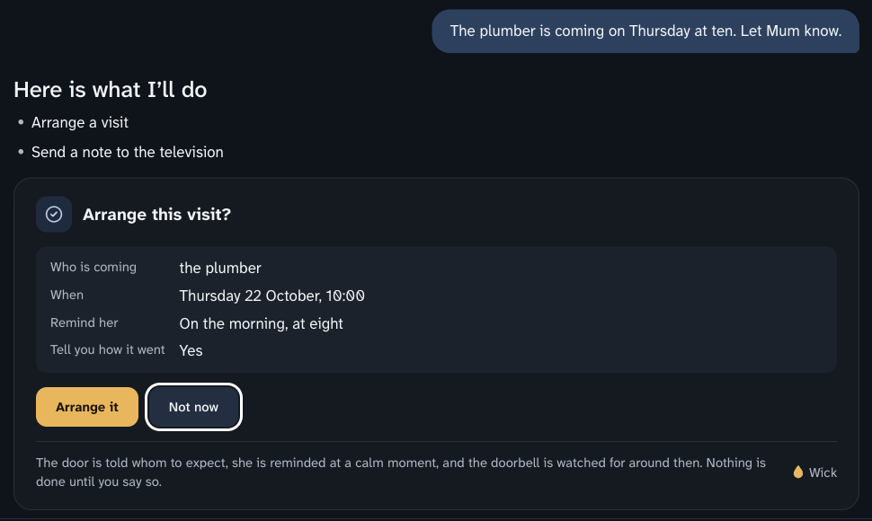

<h1 align="center">Wick</h1>

<p align="center">
  <em>The television as the care surface for the person being cared for.</em>
</p>

<p align="center">
  <a href="https://github.com/rogerjeasy/wick/actions/workflows/ci.yml"></a>
  <a href="https://github.com/rogerjeasy/wick/releases/latest"></a>
  <a href="LICENSE"></a>
  <a href="https://github.com/rogerjeasy?tab=packages&repo_name=wick"></a>
  <br>
  
  
  
  
  
</p>

<p align="center">
  <strong><a href="https://rogerjeasy.github.io/wick/media/wick-demo-1080.mp4">Watch the film (1:28)</a></strong> ·
  <strong><a href="https://dmaz25jvryojp.cloudfront.net/">Try the family app</a></strong> ·
  <a href="https://d2sbabcft8sm3m.cloudfront.net/tv.html">Her television in a browser tab</a> ·
  <a href="https://rogerjeasy.github.io/wick/calm-points/">The calm-point map</a>
</p>

<p align="center">
  <a href="docs/WICK.md">Product overview</a> ·
  <a href="docs/WICK-TECHNICAL.md">Technical document</a> ·
  <a href="docs/SETUP.md">Setup</a> ·
  <a href="FRICTION.md">Friction log</a> ·
  <a href="docs/PRODUCT-FEEDBACK.md">Product feedback</a> ·
  <a href="docs/SUBMISSION.md">Submission</a>
</p>

> **Submitted to:** Build, Ship, Shape — Amazon Developer Hackathon · **Track:** Fire TV
> **Mini challenges:** AWS Builder · Open Source

---

## The idea

Products for ageing at home are built for the caregiver: a phone app full of
alerts, checked by a daughter three hundred miles away.

Wick turns that around. It lives on the one screen an older person already
watches for more than four hours a day
([BLS American Time Use Survey, 2025](https://www.bls.gov/news.release/atus.t11a.htm)),
and asks her to install nothing, learn nothing and wear nothing. She stays in
charge: the family sees only what she has agreed to share, and everything is
answered with one button on the remote she already holds.

> **A real door, October 2026.** She is 79 and lives with memory loss. Her
> television is on most mornings, much of the afternoon and every evening.
> When she is ill, a different doctor comes each time. At the door she doesn't
> recognise them, sometimes the door stays shut, and the doctor phones her
> daughter in Italy to sort it out. Her daughter, 56, liked two things in Wick
> most: the door card and the notes.
>
> <sub>From a conversation with a woman and her daughter, October 2026. Told in
> our words; names withheld for privacy.</sub>

**The people in the demo.** Margaret lives alone. Sarah, her daughter, lives
far away. Maria is her carer. *Try the demo* makes you Sarah.

<p align="center">
  <a href="https://rogerjeasy.github.io/wick/media/wick-demo-1080.mp4">
    
  </a>
  <br>
  <sub>Recorded live in one take. Click to play with sound, or watch it with captions on the <a href="https://rogerjeasy.github.io/wick/">project page</a>.</sub>
</p>

## What it does

| | |
|---|---|
| **The door** | A ring at the door puts a card on her television in about two seconds, then the doorbell's picture and one plain sentence about who is there. If another app is in front, Wick still tells her: a system toast on Vega, a notification on Fire OS. Only the door may interrupt. |
| **The family** | Sarah asks Alexa+ *"How's Mum been this week?"* and gets a short, honest answer. Notes go to Margaret's television and wait for a natural break; she replies with one button. |
| **The rhythm** | Wick learns what a normal week looks like in this house, so it stays quiet when nothing is wrong and can say *"that's up from last week"* and mean it. |

**When she is watching another app.** No app can draw over another on Vega or Fire OS, so Wick's cards appear
only while Wick is on screen. The door still reaches her over anything: a system toast on Vega, a heads-up on
Fire OS. A note never interrupts. On Fire OS it waits quietly in the Notification Center, never over her
programme (Amazon asks apps not to put up a heads-up while another app is in front, [FL-035](FRICTION.md)). Vega
has no quiet place to leave it, so it waits in Wick. Either way it is on her screen the moment she opens Wick.

**What works where.** Most of Wick needs her to be watching in Wick, which plays three open films today.

| | In Wick: its home screen or one of its films | Another app in front: a streaming app, live TV |
|---|---|---|
| Someone at the door | The card over the film, with Ring’s picture and one sentence. The film holds. | Vega: an 8-second system toast, then a second with the picture and sentence. Each opens Wick, where the card waits five minutes. Fire OS: a heads-up notification with the picture and sentence. |
| A note, the week, a visit question, "Shall I tell Sarah?" | At the film's next measured calm point, or in a pause | Nothing on screen. Fire OS files it quietly in the Notification Center; on Vega it waits in Wick. |
| Timing at a calm point | Measured on Wick's own three films | None: Wick cannot see inside another app |
| Watch live, Read to me, Hold for Sarah | Yes | Open Wick first |

Carrying calm-point timing into the programmes she already watches would need a content or player partnership.

### Fifteen features on top

| Feature | What she sees | What it never does |
|---|---|---|
| **Her day** | Her home screen opens on her: *"Good morning, Margaret."*, the date, and who is coming, such as *"Maria usually comes tomorrow at 9 am."* The films are under it. | Say anyone came, or show a visit the door has not been told of. |
| **Ask Sarah to look** | One button on the door card asks Sarah to look at the same picture. Sarah's answer appears under her name. | Show Sarah the door unless Margaret asks. |
| **Shall I tell Sarah?** | When a day is unusual, such as the carer not coming, Wick asks Margaret first and shows her the exact sentence it would send. | Tell the family anything she keeps to herself. |
| **Calm points** | A note waits for the credits, a pause, or a quiet cut measured in the film itself. The film holds while she reads it. | Interrupt a scene. No model chooses the moment. |
| **Watch together** | Sarah invites her to a film. When Margaret presses *Start the film*, Sarah's screen follows hers. | Let anyone else touch her remote. |
| **The light in the window** | Sarah sees one thing about today: whether Margaret's day has begun. Margaret can put it out. | Say when, where or what. Her home screen shows who looked in. |
| **Hold for Sarah** | Holding OK for two seconds asks one person to ring her. If they don't answer in three minutes, the next person is asked. | Call anyone itself or raise an alarm. |
| **The visit, witnessed** | After the carer leaves, the television asks: *"Maria was here from 9:02 to 9:47. Is this right?"* | Treat a visit as confirmed until she says so. |
| **Sarah's television** | Sarah can connect her own Fire TV. It shows Margaret's light, door requests, the week and shared films. | Become Margaret's television or see more than Sarah may. |
| **Her language** | Sarah can ask for Spanish. Nothing changes until Margaret says yes on her own screen. | Machine-translate a sentence she consents by. |
| **The mantelpiece** | Sarah sends a picture. Margaret can keep it, and kept pictures fill her idle screen. | Tell Sarah whether she kept it. |
| **Read to me** | Play reads the card on screen aloud, in her language (Amazon Polly). | Speak unless she asks. |
| **Easier to see** | Larger text, at 40-point minimum, and higher contrast, at 21:1, across every screen. | Shrink a word to make it fit. |
| **Visit errands** | Sarah says *"The plumber is coming Thursday at ten — let Mum know."* Wick's agent shows her the plan; after her yes, a note waits for Margaret's natural break, the door card later says *"Sarah arranged a visit for about now"*, Margaret is reminded that morning, and Sarah is told when the door rang or that nobody came. | Say the plumber came. It says someone rang around then; whether it was them is Margaret's to say. |
| **The Sunday brief** | Margaret's week, written by agents from counted facts and checked twice, ends with one thing Sarah could do, with one button: write a note, arrange a visit or watch a film together. | Guess how she feels, or suggest anything the week's facts don't support. |

The family reaches all of it through **25 MCP tools**, and through an agent on
Amazon Bedrock AgentCore that uses those same tools with the family member's own
token and asks before every write. Every call checks again that Margaret still
allows that person.

## Try it

No account and no hardware are needed.

1. Open [her television in a browser tab](https://d2sbabcft8sm3m.cloudfront.net/tv.html). The keyboard is the remote: arrows move, **Enter** is OK, **Esc** is Back, **Space** is Play/Pause, and **Enter** held for two seconds is Hold for Sarah. On a phone or tablet, use the remote drawn beside the screen. *How Wick works*, on its home screen, shows an example of everything below without the family app.
2. Open the [family app](https://dmaz25jvryojp.cloudfront.net/), choose **Try the demo** and enter the code shown on the television (or point a phone at the QR code beside it). You are Sarah, in a demo home with six weeks of simulated history. Every press of **Try the demo** is a new demo session: a fresh key, its own guest and its own home, so nothing from anyone else's session (or your own earlier one) is ever shown. The header names the session, for example *Demo home K7F2QX*.
3. On the television, press **Allow Sarah** when it appears, about twenty seconds after pairing. Then ask the family app anything, for example *"How has my mum been this week?"*
4. Start a film, then ask the family app to *send a note to her television*. The note waits. Pause, or let Big Buck Bunny reach its calm point at 1:29, and it appears. **Space** reads it aloud; **Enter** replies.
5. Press **Ring the stand-in doorbell** in the family app and choose who is there. The door card appears at once and the film waits under it, then the picture and one sentence about it. **Esc** (Back) or *Not now* puts it away and the film goes on; if the card goes by itself while she is at the door, the film stays paused for her. The stand-in doorbell rings at most once every 20 seconds.

The same flow runs on the Vega Virtual Device and on the Fire OS build in the
Android TV emulator ([docs/SETUP.md](docs/SETUP.md)). Every Vega Virtual Device
has the same id, so one may open in another demo home with no code: in the
family app, **Connect a television** then **Bring in the Vega Virtual Device**.

## Screenshots

Eight screens, two sides of one house: what Margaret sees on her television, and what Sarah sees in the
family app. The browser television draws the same cards as the Vega app, and a parity test holds the two
together. Every family-app screen is a live answer from the deployed stack, in a demo home.

<table>
  <tr>
    <td width="50%" valign="top">
      <br>
      <sub><b>The door.</b> A ring puts a card over her film, then the picture and one sentence about it. One button asks Sarah to look. <i>Her television in a browser.</i></sub>
    </td>
    <td width="50%" valign="top">
      <br>
      <sub><b>Sarah is asked to look.</b> The same picture and three answers; hers appears on Margaret's television under her name. <i>Family app.</i></sub>
    </td>
  </tr>
  <tr>
    <td width="50%" valign="top">
      <br>
      <sub><b>A note waits for a natural break</b>, here a pause, and is answered with one button. <i>Her television in a browser.</i></sub>
    </td>
    <td width="50%" valign="top">
      <br>
      <sub><b>Shall I tell Sarah?</b> Nothing different leaves the house until she says so, and she sees the exact sentence first. <i>Vega.</i></sub>
    </td>
  </tr>
  <tr>
    <td width="50%" valign="top">
      <br>
      <sub><b>Her home screen.</b> A film she left part-way comes first; <i>How Wick works</i> shows an example of each thing Wick does, with only the remote. <i>Vega.</i></sub>
    </td>
    <td width="50%" valign="top">
      <br>
      <sub><b>The door, while another app is in front.</b> Only the door interrupts. <i>Vega Virtual Device.</i></sub>
    </td>
  </tr>
  <tr>
    <td width="50%" valign="top">
      <br>
      <sub><b>How her week went</b>, told from counts, with one thing Sarah could do. <i>Family app.</i></sub>
    </td>
    <td width="50%" valign="top">
      <br>
      <sub><b>A visit errand.</b> Wick's agent shows its plan and does nothing until Sarah says yes. <i>Family app.</i></sub>
    </td>
  </tr>
</table>

More, including the film's bar, the hold line, every step of the tour, Easier to see and the phone layouts:
[`docs/screenshots/redesign/`](docs/screenshots/redesign/). The design rules behind them:
[`docs/design/DESIGN.md`](docs/design/DESIGN.md).

## Why Amazon

Wick needs a trusted screen in the room, a doorbell with a real developer API,
and an assistant the family already uses. Only Amazon has all three.

| | Screen | Doorbell API | Assistant |
|---|---|---|---|
| **Amazon** | **Fire TV** | **Ring** | **Alexa+** |
| Google | Google TV | Nest (limited) | Gemini |
| Apple | Apple TV | none | Siri |
| Roku | Roku | none | none |

## Architecture

<picture>
  <source media="(prefers-color-scheme: dark)" srcset="docs/architecture/architecture-dark.png">
  
</picture>

<sub>Drawn from <a href="docs/architecture/architecture.html"><code>docs/architecture/architecture.html</code></a>; every box is in <code>apps/</code>, <code>services/</code> or <code>infra/</code>, and the counts are Terraform's. <code>scripts/architecture/render.sh</code> draws it again.</sub>

The television renders and never decides. The edge authenticates and answers
Ring within its five-second budget. The agents do the reasoning. The full
design is in [docs/WICK-TECHNICAL.md](docs/WICK-TECHNICAL.md).

### Technology

| | Used for |
|---|---|
| **Vega OS** | The resident's app in React Native for Vega. A headless service shows the door over other apps, media controls make a platform pause count as a natural break, `w3cmedia` plays the films and the door's live view, and Content Personalization is told what she watches as she watches it (the platform takes the reports; its Continue Watching row needs an Amazon catalogue Wick's three open films are not in, [FL-043](FRICTION.md)). |
| **Fire OS** | The same source through four small adapters, with an Android foreground service for the door, and her film as Android's `MediaSession`, so "Alexa, pause" and the remote's media keys go through the same rules as on Vega. |
| **Ring Partner API** | OAuth link, webhooks, recorded frames and live view (WebRTC bridged to HLS for the television). |
| **Alexa+ MCP** | An MCP server (spec 2025-11-25, Streamable HTTP, OAuth 2.1) with 25 tools. The add-on surface is partner-only, so a simulated Alexa+ app calls it, as the rules allow. |
| **Amazon Bedrock** | Nova Lite describes the door's picture in one sentence. Claude Sonnet 4.5 is the family's assistant and writes the Sunday brief from numbers already counted. A **Bedrock Guardrail** (denied topics, PII, contextual grounding against the counted facts) checks both. No model runs inside a tool. |
| **Bedrock AgentCore + Strands** | Three agents in AgentCore Runtime. The door's work runs as Strands graphs, one session per household. The family assistant is a Strands agent that calls Wick's MCP tools as an MCP client with the member's own token and pauses for their yes through Strands interrupts; its conversations live in **AgentCore Memory** (session storage Wick contributed to Amazon's AgentCore SDK) and it remembers the member's own words long-term. The Sunday brief is a Strands Graph: analyst, writer, check, suggester. |
| **AWS** | Lambda, API Gateway, IoT Core, EventBridge and Scheduler, **Step Functions** (a visit errand runs for days as one execution), **SQS** (the brief's fan-out), App Runner, Cognito, DynamoDB, S3, CloudFront, Secrets Manager, Rekognition, Polly, Translate and Transcribe. All in Terraform, deployed by GitHub Actions over OIDC. |

**Measured** against the deployed stack:

| Measurement | Result |
|---|---|
| Doorbell to door card | 2.3 s median, on the stand-in doorbell (Ring's own webhook hop is extra) |
| Launch to fully drawn, Vega | 722 ms mean, 632–807 ms, over 10 cold starts on the Vega Virtual Device (`vega exec perf kpi-visualizer`) |
| Memory on her home screen, Vega | 64 MiB PSS, steady over a minute, on the Vega Virtual Device (`vega exec perf memory-monitor`) |
| MCP server's own work | 18 ms p95 |
| MCP call on an open connection | 230–241 ms p95, against Alexa+'s 500 ms target (calls that stop at the access check, so without a tool's own reads: [WICK-TECHNICAL §9.3](docs/WICK-TECHNICAL.md#93-mcp-latency)) |

New connections are slower because App Runner closes idle connections
([#47](https://github.com/rogerjeasy/wick/issues/47)).

## Privacy and trust

Privacy is the product, not a compliance section.

- **No camera looks inside the home.** Ring is used at the front door only.
- **She sees everything the family sees**, on her own television, and can remove it. She reaches it at any time from her light on the home screen, and can stop Wick there: everything it keeps about her home is deleted, and her family's app says so.
- **Health, money, relationships and location are never shared as a category.** No setting turns them on. Every string a family member reads also passes a deterministic content gate, the Guardian, and property tests run it through the real tool paths. It catches what its word list names, not every way of saying it.
- **No mood detection, no wellness scores, no fall detection, no chatbot on the television.** The reasons are in [docs/WICK.md](docs/WICK.md) §6.

## What is real, and what is simulated

Wick was built without hardware, which the hackathon allows.

| | In this submission |
|---|---|
| **Television** | The Vega Virtual Device and the Fire OS build on the Android TV emulator. A browser version runs the same cards and break rules for judges without either. |
| **Doorbell** | Ring's Developer Playground, behind Ring's real API. It sends no webhooks and has no chime, so demo homes use a clearly labelled stand-in doorbell with made-up visitors ([FL-027](FRICTION.md)). |
| **Alexa+** | A simulated surface that signs in with OAuth and calls the real MCP server ([FL-001](FRICTION.md)). |
| **Household** | A demo home with six weeks of simulated history, marked as simulated everywhere. |
| **Films** | Blender Foundation's open films. |

Everything between those ends is real and deployed: the AWS stack, the MCP
server, the agents and models, the Guardian, accounts and pairing. Not yet
seen on real hardware: a Fire TV, a Ring doorbell, or a spoken "Alexa, pause".

## Repository layout

```
apps/tv-vega           Vega OS app: cards, player, natural-break engine, headless services
apps/tv-fireos         The same app on Fire OS
apps/sim-alexa         The family app, a simulated Alexa+ surface
apps/ops-console       Her television in a browser tab
services/edge-ring     Ring webhook receiver
services/edge-device   The television's channels: IoT Core and WebSocket
services/mcp-server    MCP server, OAuth, accounts and the family app's API
services/agent         Agents, Strands graphs, the live-view bridge
services/policy        The Guardian
packages/vega-calm-ui  Accessible 10-foot components, also its own repository and on npm (vega-calm-ui)
packages/strands-agentcore-session  AgentCore Memory session storage for Strands TS, also a pull request to Amazon's AgentCore SDK (aws/bedrock-agentcore-sdk-typescript#287; its integration tests pass against a real memory)
addon-package          The Alexa+ add-on manifest
infra                  Terraform
```

## Getting started

```bash
nvm use && npm ci
npm run verify   # typecheck, lint and every test; needs no AWS
```

Running it locally, on the simulators, or on your own AWS account is covered
in [docs/SETUP.md](docs/SETUP.md).

## Security

- **No long-lived keys.** CI deploys over OIDC. Each home's Ring tokens are in their own Secrets Manager secret, and the television holds one device token for its own home.
- **Every request is scoped.** A household always comes from a verified token, never from the request. Ring webhooks are HMAC-verified and idempotent.
- **Known limit.** The Vega simulator cannot keep a secret on disk, so it is only ever paired to demo homes ([AGENTS.md](AGENTS.md), INV-1).

The full threat model is in [docs/WICK-TECHNICAL.md](docs/WICK-TECHNICAL.md) §10.

## Licence

MIT. See [LICENSE](LICENSE).
