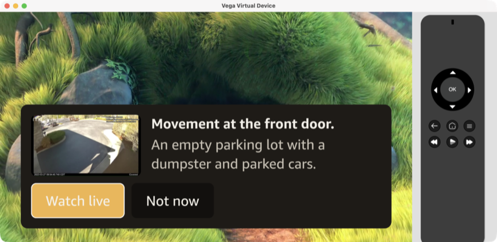
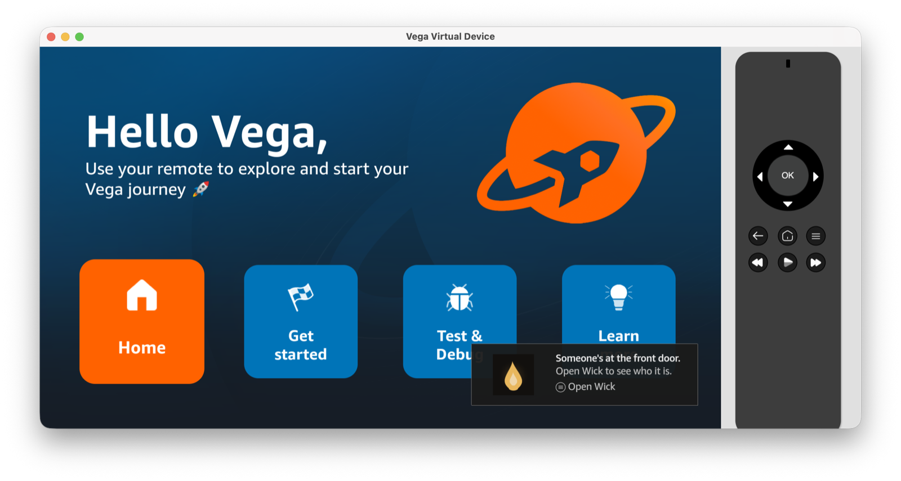
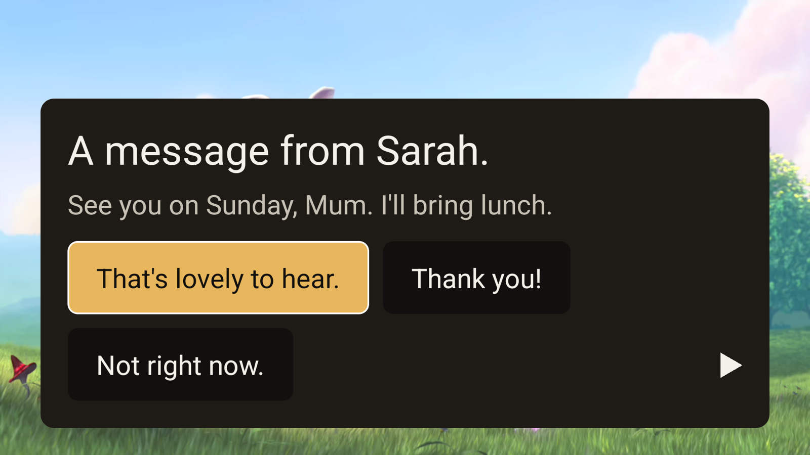
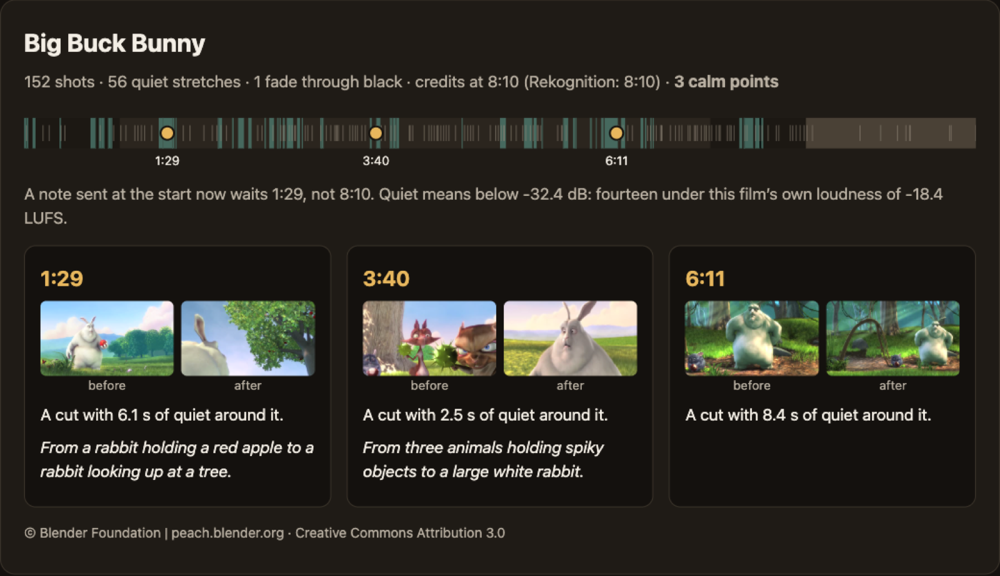
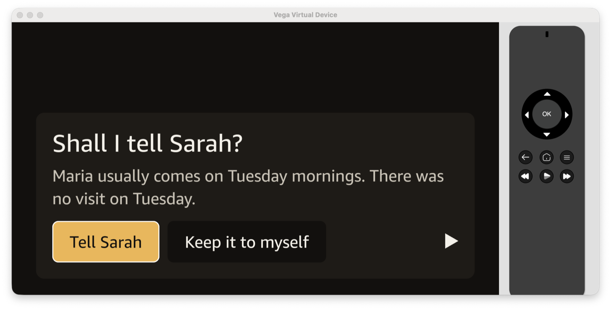
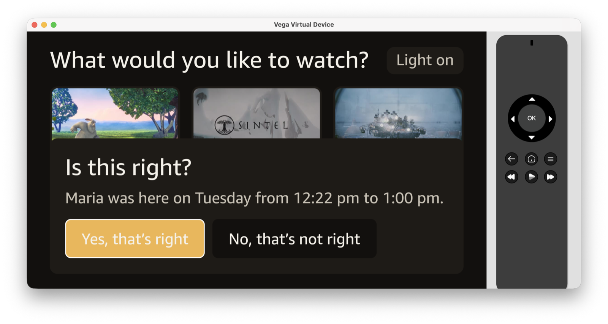
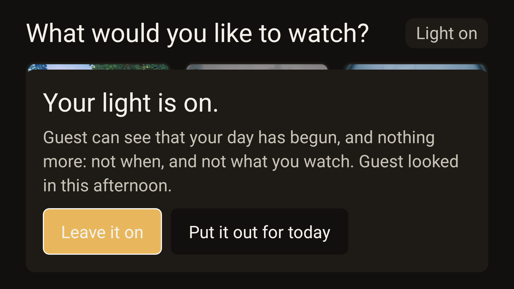
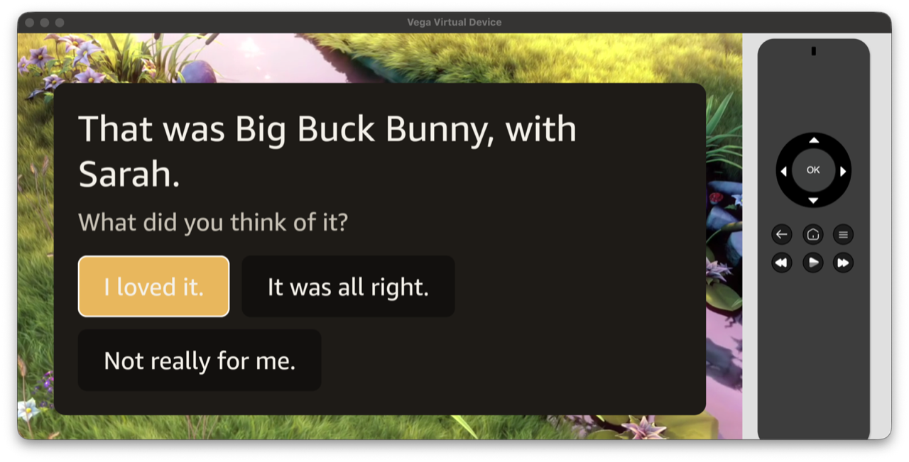
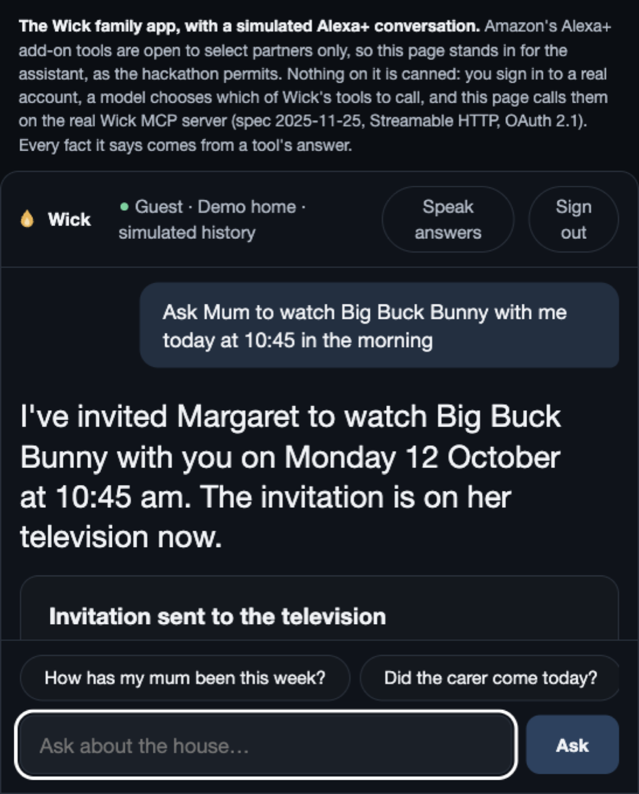
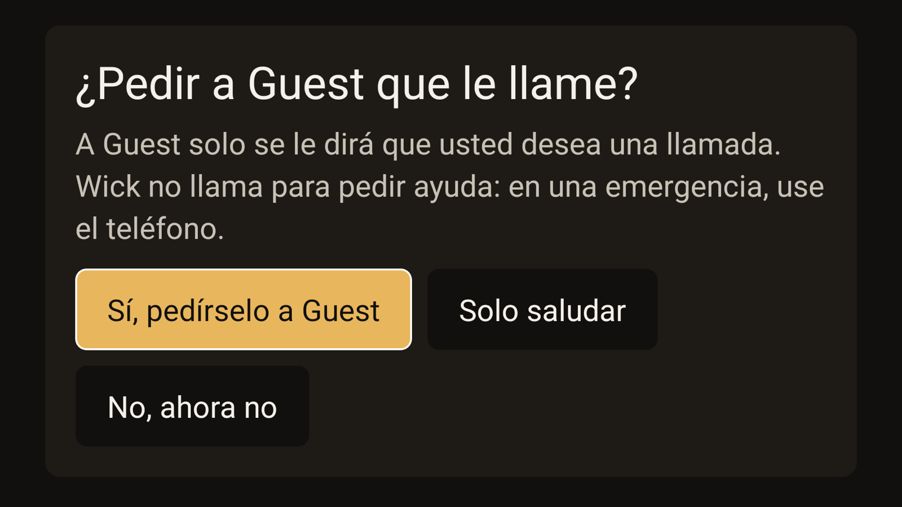

<h1 align="center">Wick</h1>

<p align="center">
  <em>The television as the care surface for the person being cared for.</em>
</p>

<p align="center">
  <strong><a href="https://dmaz25jvryojp.cloudfront.net/">Try the family app</a></strong> ·
  <a href="https://d2sbabcft8sm3m.cloudfront.net/device.html">A television in a browser tab</a> ·
  <a href="https://rogerjeasy.github.io/wick/calm-points/">The calm-point map</a>
</p>

<p align="center">
  <a href="docs/WICK.md">Product definition</a> ·
  <a href="docs/WICK-TECHNICAL.md">Technical document</a> ·
  <a href="docs/SETUP.md">Setup</a> ·
  <a href="FRICTION.md">Friction log</a> ·
  <a href="docs/PRODUCT-FEEDBACK.md">Product feedback</a> ·
  <a href="docs/SUBMISSION.md">Submission</a>
</p>

> **Submitted to:** Build, Ship, Shape — Amazon Developer Hackathon · **Track:** Fire TV
> **Mini challenges:** AWS Builder · Open Source

---

## The idea in two sentences

Every product built for ageing at home is built for the *caregiver* — a phone app,
full of alerts, checked by a daughter three hundred miles away. Wick inverts that:
it puts the intelligence **inside the home**, on the one screen someone past 75
already watches for more than four hours a day
([BLS American Time Use Survey, 2025](https://www.bls.gov/news.release/atus.t11a.htm)),
and asks them to install nothing, learn nothing, wear nothing and change nothing.

## What it does

| Pillar | What happens |
|---|---|
| **The Door** | A Ring doorbell press puts a card on the television within a few seconds. A still from the doorbell and one plain sentence describing who is actually there are added to it as soon as each is ready: Ring returns a recorded frame (about three seconds when measured), and the vision model's sentence is dropped if it takes longer than two and a half seconds, so the card never waits for it. One button rings the Ring Chime in the hallway, so whoever else is home knows someone is at the door — and the card says whether it rang. *(Built and tested against Ring's chime contract; not in the demo, because Ring's only simulator has no chime — [FL-019](FRICTION.md).)* Another opens the doorbell camera live, full screen, and Back returns to the card. And she does not have to be in Wick: if another app is in front — a film elsewhere, the Fire TV home screen — Wick's background service puts a system toast in the corner over it, *"Someone's at the front door."*, with one button that brings Wick forward to the card. When the picture and the sentence are ready, a second toast shows them. Seen on the Vega simulator, with a frame from the camera of Ring's Developer Playground. Only the door does this: a note from the family never interrupts another app. *(Vega only: the Fire OS build has no background service.)* |
| **The Family** | A distant daughter asks Alexa+ *"how's Mum been this week?"* and gets a truthful, unsensational narrative. (Here she asks a simulated Alexa+ surface; the MCP server behind it is the real one — see [what is real, and what is simulated](#what-is-real-and-what-is-simulated).) Notes go back the other way — at the end of an episode, never mid-scene — and the resident replies with one button. |
| **The Rhythm** | Wick learns what a normal week looks like in this house, so it can stay silent when nothing is wrong — and so the weekly narrative can say *"that's up from last week"* and mean it. |

### Eleven things built on those three

Each of these runs today on the deployed stack. Nine are something the
resident does with one button, on their own television. One is the same app in
the family member's living room. And one is the language all of it is said in.

| | What happens | What it never does |
|---|---|---|
| **Ask Sarah to look** | Someone is at the door and nobody is expected. One button on the door card asks the family member to look at the same picture. They answer with one of three fixed sentences — *"It's all right, I know who that is."*, *"Please don't open the door. I'll ring you now."* — and it appears on the door card under their name. | The family is never shown the picture from the door unasked. The notification that reaches their phone carries no name, no picture and no sentence. |
| **Shall I tell Sarah?** | Wick notices when a day is unlike this household's usual — the carer who comes every Friday did not come. It does not tell the family. It asks the resident, showing the very sentence that would be told, and only *"Tell Sarah"* makes that one thing readable. | *"Keep it to myself"* looks, to the family, exactly like nothing having happened. Wick never says "nothing is different": it cannot know what was kept. |
| **Calm points** | A note from the family waits for a natural break: the credits, a pause — by the remote, or on Vega through the platform's media controls ("Alexa, pause") — or a calm point inside the film — a cut that falls in silence, measured on the published encode with Amazon Rekognition and ffmpeg. The film holds on the cut while the note is read and goes on when it is answered. [The map of every calm point](https://rogerjeasy.github.io/wick/calm-points/). | A note never talks over the story, and no model chooses the moment. Only someone at the door interrupts. |
| **Watch together** | The family member invites the resident to one of Wick's films, at a day and a time. One button says yes. When the time comes they sit down, each at home, and the resident's press on *"Start the film"* lets the other screen follow hers: where she pauses, it pauses. At the credits each is asked one question and sees the other's answer. Plans change: an invitation can be taken back, and a film she said yes to can be called off — her television then says so. | No camera, no microphone, and nobody reaches her remote. Where her film has got to leaves the house only after her own press, only for that one film, and only to the person she said yes to. |
| **The light in the window** | The family sees one thing about today: a light, lit once the resident's day has begun. No time, no room, no programme. She can put it out for the day — and a light that is out looks exactly like one not yet lit, so an unlit window never says why. | Looking is never hidden from the person looked at. Her home screen says *"Sarah looked in this morning."* |
| **Hold for Sarah** | The remote is the button she already holds. OK held for two seconds, on the home screen or over a film, brings one card: *"Ask Sarah to ring you?"* Yes tells one person that she would like a call. If they have not answered in three minutes the next person in her circle is asked, and a neighbour last — someone invited for exactly this, who can also be asked to look at the door. Whoever answers chooses one sentence — *"I’m ringing you now."* — and it appears on her television under their name. *"Just say hello"* does exactly that, to one person. | Wick rings nobody, calls no service and sounds nothing, and the card says so. Nobody is told why she asked. Someone not yet asked is not told there is a request at all. A neighbour sees nothing else about the house. The hold is heard while Wick is on screen, not from inside another app. |
| **The visit, witnessed** | The carer rings at 9:02 and the door knows her from the roster. The door next sees somebody at 9:47: she has left. At the next natural break the television asks: *"Is this right? Maria was here on Tuesday from 9:02 am to 9:47 am."* One press — *"Yes, that’s right"* — makes it a visit the resident herself confirmed, and the family can ask *"were this week’s visits confirmed?"* (The two door events come from a signed stand-in for the doorbell, `scripts/visit-sighting.sh`: Ring's Playground sends none — [FL-027](FRICTION.md).) | The times are the door's reading, never called a fact, and nothing but her press confirms one. *"No, that’s not right"* tells nobody: whether the family hears she disputed a visit is hers to decide, and until then it looks exactly like one she has not been asked about. It is not a clinical or billing record. |
| **Sarah's television** | The same app, connected by a family member as their own: the family app asks *"Whose television is it?"* and they choose *Mine*. Its home screen says one sentence about the light in Mum's window. When she asks them to look at the door, the picture and the three answers come up there; when she asks to be rung, that does. Her week can be read there once she has read it herself — the paragraph, then a page a day. One button sends a wave; her television says *"A wave to you from Sarah's television."* at a quiet moment, and she can wave back. And the member who invited her to a film can sit down there: its player follows hers, pauses where she pauses, and shows both answers at the credits. Seen working on the Fire OS build (on the Android TV emulator) and on the television in a browser tab, against the deployed stack. | It is never her television. It is given none of her cards and cannot be turned into hers, and its token is good for asking one server for one member's view ([`AGENTS.md`](AGENTS.md), INV-1). It shows only what that member may already read, asks again on every look whether she still allows them, and a neighbour cannot connect one. A look from it is noted on her home screen like any other. A wave she puts away looks, from there, exactly like one she has not seen. Its player has no pause and no skip: nobody reaches her remote. On Vega its background service is built to say, in a system toast, what is waiting while another app is in front; the token hand-off behind that was checked against the deployed services, but the toast itself has not been seen on a family television, and Fire OS has no such service. On the Vega simulator, which keeps nothing on disk ([FL-013](FRICTION.md)), a family television has to be connected again each time the app starts. |
| **The television speaks her language** | The person who set the home up asks, in the family app, for her television to speak Spanish. Nothing changes until she answers on her own television — a card in both languages at once, *"¿Quiere que Wick le hable en español?"* — and from her yes the home screen, every question and every button are Spanish: *"¿Se lo digo a Sarah?"*, *"Wick no llama para pedir ayuda: en una emergencia, use el teléfono."* Everything Wick itself says comes from a phrasebook of whole sentences written by hand and held, by tests, to the English the rest of the system writes. Only what a person or a model wrote — a note from the family, the door's description, the week's paragraph — is machine-translated, by Amazon Translate, on its way to her screen. Seen working on the Fire OS build (on the Android TV emulator) and on the television in a browser tab, against the deployed stack. | Nothing translated leaves the house: her answers are keys, a note's reply is the stored English words, and every answer the family is given reads as it did before. A sentence she consents by is never left to a machine: one the phrasebook does not hold stays in English, whole. Her no stands for a week, and a question taken back cannot be asked again for a day. Spanish is the only language beside English so far. A family member's own television, the pairing screen and the system toast stay in English, and the films have no captions. The door's card and "Shall I tell Sarah?" have not been seen in Spanish on a television: a demonstration home has no doorbell. |
| **The mantelpiece** | Someone in the family sends a picture from the family app. The browser scales it and sends only the picture itself — not where or when it was taken — and the server has Amazon Rekognition look at it before it goes anywhere. It arrives on her television at a quiet moment, whole, beside *"A picture from Sarah."*, with two answers that both put it away: *"Keep it"* and *"Thank you"*. What she keeps opens from her home screen, one picture at a time, with *"Leave it"* first and *"Take it down"* second. And when the home screen has sat untouched for three minutes, her kept pictures fill it, twenty seconds each, until any key is pressed. Seen working on the Fire OS build (on the Android TV emulator) and on the television in a browser tab, against the deployed stack. | The family is told one thing whichever she pressed — *"Margaret has seen your picture."* — so kept, not kept and taken down later look exactly the same from outside. A picture carries no words of the family's. Its address is made for her television when it asks, lives an hour, and is written nowhere. Twelve fit; six can be sent in a day; a neighbour sends none; a picture the check cannot be made on is not sent. The idle screen delays no card and makes nothing disappear. |
| **Read to me** | While a card is on her screen, the Play key reads it aloud in her language: its sentences, then what she can press. There is no fourth button; a small mark on each card says so. The voice is Amazon Polly's, made when she asks and kept a day. Over a note that is holding her film, the first Play reads it and the second carries on with the film. Seen working on the Vega simulator — the reading is made, and a second player plays it to its end while the film stays held — and on the television in a browser tab. On the Fire OS build (Android TV emulator), Play over a held note left the note and the held film in place; that the reading played there was not confirmed, and its Android audio path has not been heard. | Wick never speaks by itself: a card that read itself aloud would be the beep it promises not to make. Nothing is read that is not on her screen. Nothing about a reading reaches the family — there is no record that she asked. On the simulators the sound cannot be listened to: what was seen is the player playing. |
| **Easier to see** | One pill on her home screen opens a card with three buttons: *Larger text*, *Higher contrast*, *Back*, each saying how it stands. Larger text sets every word 1.25 times the size, so the 32pt floor becomes 40pt, and the films' pictures give way to the words; higher contrast is pure black and white with a thicker focus ring. It changes every screen at once, and follows the television's own high-contrast setting until she chooses. With VoiceView on, each card is announced once and her pictures never start moving on an idle screen. Seen on the Vega simulator ([screenshots](docs/screenshots/easier-to-see-home-both-vega.png)). | Cut a word to make it fit: a card whose words would not be whole at 40pt is drawn at the standard size. Tell anyone what she chose: it is kept on that television alone. |

The family reaches all of it through the MCP server's twenty-two tools — the week,
today, visitors and their visits, notes and replies, the door, watching together,
the light, being asked to ring, whether a picture has been seen — and
every one of them asks again, on every call, whether the resident still allows
that person ([`AGENTS.md`](AGENTS.md), INV-9).

### Try it

No account and no hardware are needed.

1. Open the [family app](https://dmaz25jvryojp.cloudfront.net/) and choose **Try the demo**. You get a guest account and a demo home of your own, with six weeks of simulated history.
2. Open [a television in a browser tab](https://d2sbabcft8sm3m.cloudfront.net/device.html), press **Pair & connect**, and enter its code in the family app.
3. On the television, allow yourself. From then on, ask the family app anything — *"How has my mum been this week?"*, *"Is the light on?"*, *"Ask Mum to watch Sintel with me on Sunday at three"* — and answer on the television.
4. To see the door, press the **Ring the stand-in doorbell** chip and choose who is there. A demo home has no Ring doorbell, so this stands one in. The door card comes up on the television within a few seconds, then the picture, then a sentence about it from the vision model. Press **Ask Guest to look** there, and the family app shows you the picture to answer.
5. For the family's side on a television, open a second television tab, press **Pair & connect**, and in the family app answer *"Whose television is it?"* with **Mine**.

## What it looks like

Taken during live checks against the deployed stack. The televisions are
simulators; the doorbell picture is from Ring's Developer Playground camera;
the household is a demo home.

| | |
|---|---|
|  |  |
| **The door card**, over a film. Vega Virtual Device, 11 October 2026. | **The door, while another app is in front**: Wick's background service posts a system toast. Vega Virtual Device, 11 October 2026. |
|  |  |
| **A note at a calm point**: the film holds on a quiet cut while it is read. Fire OS build on the Android TV emulator, 12 October 2026. | **The calm-point map**, published from what Rekognition and ffmpeg measured. [Live page](https://rogerjeasy.github.io/wick/calm-points/), 12 October 2026. |
|  |  |
| **Shall I tell …?** A day unlike the usual is put to her first. Vega Virtual Device, 12 October 2026. | **The visit, witnessed.** Only her "Yes" confirms it. Vega Virtual Device, 13 October 2026. |
|  |  |
| **The light in the window.** Fire OS build on the Android TV emulator, 12 October 2026. | **Watch together**, at the credits. Vega Virtual Device, 12 October 2026. |
|  |  |
| **The family app**, signed in as a demo guest, in a browser against the deployed stack, 12 October 2026. | **Hold for Sarah, in Spanish.** Fire OS build on the Android TV emulator, 13 October 2026. |

"Guest" is the name a demo account is given; "Margaret", "Sarah" and "Maria"
are the demo home's fictional people.

## Why this needs Amazon

Wick requires a trusted screen in the room, eyes at the door with a real developer
API, and a voice endpoint the distant family already owns.

| | Screen | Doorbell API | Assistant | Can build Wick? |
|---|---|---|---|---|
| **Amazon** | Fire TV | **Ring** | **Alexa+** | **Yes** |
| Google | Google TV | Nest (limited 3P) | Gemini | No |
| Apple | Apple TV | — | Siri | No |
| Roku | Roku | — | — | No |

Wick is not an app that happens to run on Fire TV. It is an argument for why Fire
TV sits at the centre of the Amazon home.

## Architecture

```
   Margaret's house                                               Sarah, anywhere
 ┌────────────┐  MQTT (IoT Core)  ┌──────────────────────────┐  MCP   ┌────────────────┐
 │ Fire TV    │◀─ or WebSocket ──▶│ Edge: API Gateway,       │◀─────▶│ Family app     │
 │ Vega app / │                   │ IoT Core, Lambda         │ HTTPS │ (stands in for │
 │ Fire OS    │                   │ Wick server: App Runner  │       │  Alexa+)       │
 └────────────┘                   │ ──────────────────────── │       └────────────────┘
 ┌────────────┐                   │ Agent plane: Lambda +    │
 │ Ring       │──── webhook ─────▶│ AgentCore (Strands)      │
 │ + Chime    │◀───── REST ───────│ Door · Narrator · Tell · │
 └────────────┘                   │ Visit · Reach            │
                                  │ GUARDIAN (policy)        │
                                  │ ──────────────────────── │
                                  │ Memory: DynamoDB, S3,    │
                                  │ Secrets Manager          │
                                  └──────────────────────────┘
```

In this submission the Fire TV is the Vega Virtual Device and the Fire OS
build on the Android TV emulator, Ring is Ring's Developer Playground, and
Alexa+ is a simulated surface (the family app). Everything between them is deployed and real —
[what is real, and what is simulated](#what-is-real-and-what-is-simulated).

Four planes with load-bearing boundaries: the **device** renders and never
decides; the **edge** authenticates and acknowledges inside Ring's 5-second
budget; the **agent** plane does all reasoning; the **memory** plane holds the
household's rhythm. Full detail in [`docs/WICK-TECHNICAL.md`](docs/WICK-TECHNICAL.md).

### Why these technologies

| Choice | Reason |
|---|---|
| **Vega OS** (`@amazon-devices/react-native-kepler`) | The platform Amazon is actively investing in. Wick uses two of its least-exploited surfaces — headless services and Content Personalization — for exactly what they were built for. |
| **`kepler-content-personalization`** | Gives the platform correct Continue Watching behaviour *and* gives Wick a genuine behavioural signal with no new sensor. Its `creditsPositionMs` field is the platform's own model of "the episode is ending" — which is precisely the signal the Natural-Break Engine needs. |
| **`headless-task-manager`** + the `NotificationManager` | Wick's card service is a separate Vega process that keeps a background connection while another app is in front. A door card that reaches it becomes a system toast over that app — the one way a third-party Vega app can be seen from outside itself — and the toast's button brings Wick forward. Nothing documents how; [FL-022](FRICTION.md) and [FL-026](FRICTION.md) record what the platform accepts. |
| **`kepler-media-controls`** | Makes her film a media session of the platform's, so "Alexa, pause" and the system's transport controls reach it — and a pause made that way is a natural break like any other. Every command goes through the rule her remote's keys obey: "play" over a held note carries on with the film and never reads the card, Stop is a pause, and a family member's seat refuses them all. The manifest offers only Play, Pause, Stop, start over and skip; there is no playlist, so no Next. On the Vega simulator the system's Stop reached the session and paused the film, and five seconds later it was a break; a spoken "Alexa, pause" could not be tried there, because the simulator takes no voice ([FL-031](FRICTION.md)). Fire OS has no media session yet. |
| **Ring Partner API** | Live WHEP video (bridged to HLS for the TV's own player), recorded frames, event history — and `media/audio/playback`, which lets a button on a TV remote ring the Chime in the hallway (built and contract-tested; the Playground simulates cameras only, so it is not demonstrated — FL-019). |
| **Strands Agents + Bedrock AgentCore** | The door's work runs as Strands graphs in one AgentCore Runtime: a vision Agent describes the visitor, and deterministic nodes gate the hallway chime and the live view, because no model should decide to make a sound in someone's home. Session = household, so each household's graphs run in their own microVM. |
| **Amazon Bedrock: two models, two jobs** | **Amazon Nova Lite** (`amazon.nova-lite-v1:0`) writes the one sentence about the door's picture: fast and cheap, and it describes rather than reasons. **Claude Sonnet 4.5** (`us.anthropic.claude-sonnet-4-5-20250929-v1:0`) writes the weekly narrative from numbers the Narrator has already counted — the model never counts — and, in the family app, chooses which of Wick's tools answers a question. No model is called inside an MCP tool. |
| **The AWS stack** | **AWS Lambda** for every edge handler and most agents; **Amazon API Gateway** (HTTP API for Ring and pairing, WebSocket for the television's fallback channel); **AWS IoT Core** (MQTT, with a custom authorizer on the television's own token); **Amazon EventBridge** as the bus; **AWS App Runner** for the Wick server; **Amazon Cognito** for family sign-in; **Amazon DynamoDB**, one table; **Amazon S3 + CloudFront** for the family app, the browser television, the films and the live view; **AWS Secrets Manager**, one Ring secret per household. All in Terraform ([`infra/`](infra/)), deployed by GitHub Actions over OIDC. |
| **Amazon Rekognition, Polly, Translate** | Rekognition checks a family picture before it goes anywhere, and measured the quiet cuts in each film for calm points. Polly reads a card aloud when she presses Play. Translate turns free text — a note, the door's sentence, the week — into her language; Wick's own sentences are written by hand. |
| **Amazon EventBridge Scheduler** | The three minutes between one person being asked to ring and the next are a one-time schedule that calls the card-action function back and deletes itself. Nothing of Wick's runs during the wait, and the schedule carries a request and a step — never a name. |
| **Amazon Transcribe** (streaming) | In the family app a family member can press the microphone and ask out loud. The page sends that one utterance, ten seconds at most, to the Wick server, which streams it to Transcribe and asks the words exactly as if they had been typed; the recording is kept nowhere and logged nowhere, and her television has no microphone. Built and tested, and seen working in a local browser against a stand-in for Transcribe; not yet seen working against the deployed stack. |
| **MCP server** (spec 2025-11-25, Streamable HTTP) | The family's endpoint, built to Alexa+'s own published requirements. Alexa+ asks for a round trip under 500 ms, which is why the weekly narrative is precomputed and no tool calls a model. Measured honestly, the deployed server does not meet it yet: about half of all calls take 0.75–1.15 s from a laptop in Europe, and the preflight's five-call median hides that ([issue #47](https://github.com/rogerjeasy/wick/issues/47)). The Alexa+ add-on surface is partner-gated ([FL-001](FRICTION.md)), so it is exercised through an MCP client and a simulated Alexa+ surface, the alternative the rules permit. The add-on package itself is complete: `npm run addon:check -- --live` runs what Amazon documents a deploy to need (manifest fields, image sizes, the 401, PKCE, the tool list, a median round trip) against the deployed stack. It has not been uploaded to Amazon, and cannot be. |

## The trust model

Privacy here is the product, not a compliance section.

1. **No camera ever shows the inside of this house to anyone.** Ring is used for the front door and for the fact that someone arrived. Never to watch the resident.
2. **The resident can see everything the family can see** — on their own television, and can remove anything from it permanently with one button.
3. **Nothing about health, money, relationships or where they go is passed to the family — not with permission, not ever.** A policy engine ([`services/policy`](services/policy)) refuses those classes under every household policy. Free text is read before any family member sees it: the door camera's sentence, the week's paragraph, a visitor's name, the assistant's reply. A hand-written lexicon reads it on the Wick server, where the family's tools and their own televisions are answered, and what it cannot clear is held back in a shape that already happens — a door card with no sentence, a week told from its counts — so holding back says nothing either. A note's words go back only to the person who wrote them. Property tests run through those real paths, not through a function nothing calls. The limit, plainly: a lexicon catches what it lists. It stops Wick passing such a fact on by accident; it does not stop someone set on spelling one past it.
4. **Wick reports what was said and what happened, never what it thinks you felt.** No mood detection. No wellness scores.

Deliberately **not** built: indoor camera streaming, fall detection, a chatbot on
the television, a wellness score, gamification, location tracking, sentiment
inference. Reasoning in [`docs/WICK.md`](docs/WICK.md) §4.6.

## What is real, and what is simulated

Wick was built and tested without hardware, which the hackathon allows. There
is no physical Fire TV, no physical Ring doorbell, and no real resident: nobody's
home was recorded to make this.

| | In this submission |
|---|---|
| **Television** | The Vega Virtual Device, and the Fire OS build on the Android TV emulator (Amazon publishes no Fire OS emulator; the hackathon FAQ names this one), running the same builds a Fire TV would (`apps/tv-vega`, `apps/tv-fireos`). For anyone with neither, a virtual television in a browser tab (`apps/ops-console/device.html`) pairs with the same code and is sent the same cards. |
| **Doorbell** | Ring's Developer Playground: a simulated camera behind Ring's real Partner API, linked by Ring's real OAuth. The Playground has no chime, so the hallway chime is built and contract-tested but not shown ([FL-019](FRICTION.md)). It sends no doorbell or motion webhook either ([FL-027](FRICTION.md)), so a demo home has a stand-in doorbell of Wick's own, rung from the family app. It never reaches Ring. Its four visitors are pictures made with an image model, of nobody real ([`docs/demo-door`](docs/demo-door/NOTICE.md)). The card says *stand-in doorbell* and offers no Watch live, since there is no camera. Everything after the ring is the Door agent's own path: the card, the timeline, the vision model's sentence, *Ask … to look*, and her language. |
| **Alexa+** | A simulated Alexa+ surface (`apps/sim-alexa`): the add-on surface is open to select partners only ([FL-001](FRICTION.md)). It signs in to a real account by OAuth 2.1, a model chooses which of Wick's tools to call, and each call goes to the real MCP server. |
| **The household** | A demo home. Its six weeks of history are simulated — written as the Door agent's own event rows and counted by the Narrator's own code — and every such row, week and home is marked `simulated`. The family app says so wherever it names the home. |
| **The films** | Blender Foundation's open films — Big Buck Bunny, Sintel, Tears of Steel — shown with their attribution. |

What is not simulated is everything in between: the deployed AWS stack, the
MCP server, the agents and the models they call, the Guardian, accounts and
pairing, and the channel to the television. Every press in the demo, on either
simulator, travels through it.

Test fixtures exist (redacted, under `__tests__`) but no mock path is reachable at
runtime: `npm run check:no-mocks` fails the build if Vega runtime code imports
anything matching `/mock/i`.

## Repository layout

```
apps/tv-vega        Vega OS application — cards, player, break engine, headless services
apps/tv-fireos      The same source on Fire OS, through four adapters (runs on the Android TV emulator)
apps/sim-alexa      The family app: a simulated Alexa+ surface, a client of the real MCP server
apps/ops-console    A virtual television in a browser tab, for anyone with no Fire TV to hand
services/edge-ring  Ring webhook receiver — HMAC verify, idempotency, sub-5s ACK
services/edge-device The television's two channels: IoT Core (MQTT) authorizer, presence and events; WebSocket connect/disconnect/route
services/mcp-server The Wick server: MCP endpoint, OAuth, accounts, the family app's API (App Runner)
services/agent      Agents, Strands graphs, the live bridge, and the single egress module (INV-2)
services/connectors Ring client
services/policy     The Guardian — pure, AWS-free, exhaustively tested
packages/contracts  Shared types
packages/vega-calm-ui  ← open-source extraction: accessible 10-foot components
infra               Terraform
addon-package       Alexa+ add-on manifest; the family app draws Wick's listing from it
scripts             Build, check and operator scripts
docs                Product and technical documents, setup, screenshots, the calm-point map
```

## Getting started

```bash
nvm use && npm ci
npm run verify            # typecheck + lint + no-mocks guard + every test; needs no AWS
```

Everything else — running the whole family journey locally with no AWS, the
Vega app on the Vega Virtual Device, the Fire OS build on the Android TV
emulator, and deploying your own stack with Terraform, Ring and Bedrock — is in
[`docs/SETUP.md`](docs/SETUP.md).

## Security

No static AWS keys anywhere — CI authenticates via GitHub OIDC. Each household's
Ring tokens live in an AWS Secrets Manager secret of its own, are read at runtime
only for the home being acted for, and never touch the television — which holds
a single device-bound JWT scoped to receiving cards for one household — nor the
family app, nor the Wick server. A home's organiser connects Ring from the family
app, and the link is made only when that same organiser, in the browser that
signed in at Ring, finishes it. Ring webhooks are
HMAC-SHA256 verified with constant-time comparison and idempotency on
`request_id`.

A television's id is not a secret, so it is not what a token is minted for. A
television that can keep a file keeps a random secret — made on Fire OS from
Android's `SecureRandom`, in the browser television from Web Crypto, and for a
Vega television (which has no generator of its own) by the server at pairing,
handed over once with the token; the server keeps
only its hash, and refreshes that television's token only for that secret. A
television paired again gets a new id and secret, and its old row is removed.
The family app never receives a device id (it names a television by a random
reference), and no log carries one.

What is still open, said plainly: the Vega Virtual Device keeps nothing on
disk (FRICTION.md FL-013), so it can keep no secret, its id is the constant
`wick-tv`, and anyone can mint a one-hour token for the home it is paired to —
read that home's cards, and press its consent buttons. That is why the
simulator is only ever paired to a demo home. Televisions paired before
2026-10-14 are under the same exception until their updated app enrols a
secret. The rule and its limits are in [`AGENTS.md`](AGENTS.md) INV-1; the
threat model in [`docs/WICK-TECHNICAL.md`](docs/WICK-TECHNICAL.md) §10.

## Licence

MIT — see [LICENSE](LICENSE).
