# Wick: technical document

How Wick is built, as the code stands. [`WICK.md`](WICK.md) says what Wick is and why; this document says how.

| | |
|---|---|
| **Version** | 3.0, 16 October 2026 |
| **Hackathon** | Build, Ship, Shape. Fire TV track; AWS Builder and Open Source mini challenges |
| **Readers** | Engineers first. Each part opens with a plain summary for everyone else. |
| **Authority** | On behaviour, `WICK.md` wins. On mechanism, this document wins. Where either disagrees with the code, the code is right. |

What is simulated in this submission (the televisions, the doorbell, Alexa+ and the household) is set out in the README's [*What is real, and what is simulated*](../README.md#what-is-real-and-what-is-simulated). Ideas that were planned and not built are in [§17](#17-considered-and-not-built).

**Contents.** Summary · [0 Reading this document](#0-how-to-read-this-document) · [1 Architecture](#1-architecture) · [2 Repository](#2-repository-layout) · [3 The television](#3-the-television) · [4 Device and cloud](#4-device--cloud) · [5 Agents](#5-the-agent-plane) · [6 The Guardian](#6-the-guardian) · [7 Connectors](#7-connectors) · [8 Data](#8-data-model) · [9 Performance](#9-performance) · [10 Security](#10-security) · [11 Observability](#11-observability) · [12 Testing](#12-testing) · [13 Build and deploy](#13-build-deploy-extract) · [14 Spikes](#14-the-spikes-and-what-they-found) · [15 Build order](#15-build-order-as-it-happened) · [16 Open questions](#16-open-technical-questions) · [17 Not built](#17-considered-and-not-built) · [18 The assistant as an agent](#18-the-family-assistant-as-an-agent) · [19 Visit errands](#19-visit-errands) · [20 The Guardrail](#20-the-guardrail) · [21 The Sunday brief](#21-the-sunday-brief) · [Appendices](#appendix-a--verified-vega-identifiers)

---

## Summary

Wick is a Fire TV app for an older person living alone, a cloud service on AWS, and a family surface reached through Alexa+. The television shows cards and takes one-button answers. The cloud does all the reasoning. The family can only read what the resident allows.

The architecture rests on seven decisions.

1. **The television decides nothing.** It renders cards and reports presses. It holds one scoped token and no other credential.
2. **She consents on her own screen.** Nobody reads her home until she presses *Allow*, checked on every request, and nothing unusual is told until she presses *Tell*.
3. **Rules guard the family, not models.** Every string the family reads passes a deterministic gate, the Guardian. No model decides what is private.
4. **Models describe; code counts.** Nova Lite writes one sentence about a picture. Claude Sonnet 4.5 writes the week from numbers the code already counted. No model runs inside a family tool.
5. **A note never interrupts the story.** Cards wait for a natural break that the player measures. Only the door interrupts.
6. **The household comes from the token.** No request can name another home.
7. **Managed services, one table.** Lambda, App Runner, IoT Core, EventBridge and a single DynamoDB table, all in Terraform, deployed over OIDC.

### What drives the architecture

| Quality | What it means here | How the design answers |
|---|---|---|
| **Her control** | Nothing about her leaves the house without her press | Allow and Tell on her television; checked on every call (INV-9, INV-10) |
| **Privacy** | Health, money, relationships and location never reach the family | A rules-only Guardian on every family-bound string, held by property tests (INV-2, INV-4) |
| **Calm** | The television never nags or interrupts | A natural-break engine; no red, no badges, no sound, no countdowns (INV-5) |
| **Accessibility** | A person with low vision and little technology can use it | 32-point type, 7:1 contrast, three actions at most, D-pad and OK only, larger-text and high-contrast modes |
| **Speed at the door** | A ring must reach the screen in seconds | A card first, then the picture, then the sentence, each as it is ready (§5.2) |
| **Alexa+ fit** | Tools answer within 500 ms | No model in a tool; the week is precomputed; one read per answer (§9.3) |
| **Honesty** | No confident guesses | Unsure descriptions are dropped; visits are confirmed only by her |
| **Operability** | One developer runs it | Serverless, Terraform, CI deploys, alarms, a live smoke test |

---

## 0. How to read this document

### 0.1 Verification markers

| Marker | Meaning |
|---|---|
| **✅ V** | Verified against Amazon documentation, an `AmazonAppDev` sample, or the running system |
| **⚠️ C** | Structurally right; the exact field was not read |
| **🔬 S** | Answered by a spike (§14) |

### 0.2 The three facts that shaped every decision

1. **Vega gives third-party apps no camera, microphone or presence sensor.** ✅ V. So all sensing is off the television, and Ring is the eye.
2. **Alexa+ asks for MCP round trips under 500 ms, and its MCP Toolkit is partner-only.** ✅ V. So no tool waits on a model, and the server is exercised through a simulated Alexa+ surface, as the rules allow.
3. **Ring wants a webhook acknowledged within 5 seconds and refuses browser origins.** ✅ V. So the edge verifies and hands on, and the television never holds a Ring credential.

### 0.3 Non-negotiable invariants

Enforced by code and tests; breaking one is a build break. [`AGENTS.md`](../AGENTS.md) has the full text, the accepted exceptions and the files that enforce each.

| # | Invariant |
|---|---|
| **INV-1** | No Ring or AWS long-lived credential is on the television. It holds one device-bound token. |
| **INV-2** | Every string a family member is handed passes the Guardian at the Wick server. `egress.ts` is the only module that may import a transport, push or translation client. |
| **INV-3** | No Ring image or video is kept beyond one day, by S3 lifecycle rule. |
| **INV-4** | Nothing protected and nothing verbatim reaches the family, under any policy. |
| **INV-5** | Deferred cards never show during `IN_SCENE`. Only `DOOR` is immediate. |
| **INV-6** | Every agent action is idempotent and carries a correlation id. |
| **INV-7** | She sees her week before any family tool can read it. |
| **INV-8** | A request's household comes from a verified token, never from the request. |
| **INV-9** | Nobody reads a household before she allows them, with one press. Checked on every call. |
| **INV-10** | Nothing unusual leaves the house before she says *Tell*. |

---

## 1. ARCHITECTURE

*In short: the television shows, the cloud thinks, and the family reads through a gate.*

### 1.1 Context

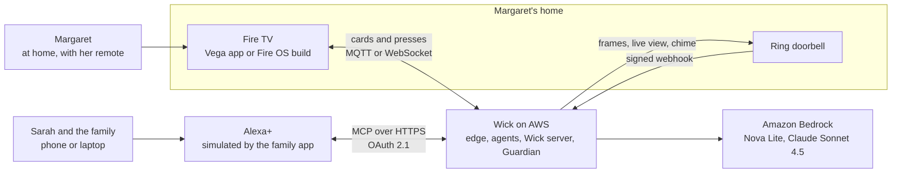

**Four planes, and the boundaries are load-bearing.**

| Plane | Does | Never does |
|---|---|---|
| **Device** | Renders cards, plays films, reports presses and playback | Decide what to show, hold a credential, run a model. Its one decision is *when*, because only the player knows where the film is (§3.4). |
| **Edge** | Terminates Ring webhooks, the television channels and MCP; authenticates; acknowledges Ring within 5 s | Call a model, or send anything to the family |
| **Agent** | All reasoning and every outbound card | Know transport details; those live in `egress.ts` |
| **Memory** | Timeline, rhythm counts, weeks, cards, memberships | Interpret anything |

The rule that keeps this clean: an `if` about *whether* to show something belongs in the agent plane, not the television.

### 1.2 Why the thinking is off-device

1. **Security (INV-1).** A cheap stick in someone's living room is not a credential store, and Vega documents no hardware keystore.
2. **Availability.** The agents must run when the television is off; Vega services live only while the app does.
3. **Speed of change.** A prompt change should not need a device release.

### 1.3 Runtime topology, as deployed

One AWS account, `us-east-1`, all in `infra/*.tf`.

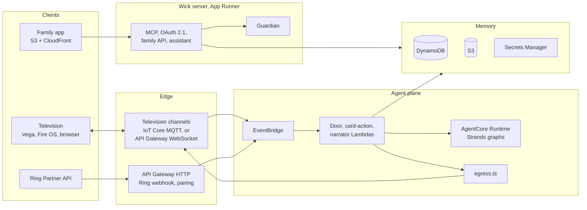

| Component | Service | Terraform |
|---|---|---|
| Ring webhook, link, token refresh | API Gateway HTTP API, Lambda; hourly rule | `edge.tf` |
| Event bus | EventBridge bus `wick` | `core.tf` |
| Door agent | Lambda `wick-agent-door-event` | `agent.tf` |
| Door description, chime, live view | Strands graphs in one **AgentCore Runtime**; session = household | `agentcore.tf` |
| Live view bridge (WHEP to HLS) | Container Lambda; segments in S3 behind CloudFront | `live.tf` |
| Presses, tell, visit, hold for Sarah | Lambda `wick-agent-card-action`; **EventBridge Scheduler** for the three-minute wait | `card-action.tf`, `reach.tf` |
| Weekly narrative | Lambda on `cron(0 20 ? * SUN *)` | `narrator.tf` |
| Television channel A | **AWS IoT Core**, MQTT over WSS | `iot.tf` |
| Television channel B | API Gateway WebSocket | `transport.tf` |
| Pairing | API Gateway, Lambda; RS256 key in Secrets Manager | `pairing.tf` |
| Wick server | **App Runner**, one container (1 vCPU, 2 GB) | `mcp.tf` |
| Family sign-in | **Amazon Cognito** | `accounts.tf` |
| Family app, browser television, films | S3 + **CloudFront** | `sim-alexa.tf`, `ops-console.tf`, `programmes.tf` |
| Pictures, readings, translation, voice | **Rekognition**, **Polly**, **Translate**, **Transcribe** | `photos.tf`, `speech.tf`, `agent.tf`, `mcp.tf` |
| Data | **DynamoDB** `wick`; S3 media with one-day rules; **Secrets Manager** | `core.tf` |
| Alarms | CloudWatch alarms to SNS; dead-letter queue on the door path | `alarms.tf` |
| CI to AWS | GitHub OIDC and a deploy role; no static keys | `github-oidc.tf` |

Counted from the Terraform: 26 Lambda functions, 1 AgentCore runtime, 1 AgentCore memory, 1 Step Functions state machine, 3 SQS queues (the brief's queue and two dead-letter queues), 1 Bedrock Guardrail, 1 App Runner service, 1 DynamoDB table, 5 S3 buckets, 4 CloudFront distributions, 2 API Gateway APIs and 1 IoT authorizer.

### 1.4 The agents

Each lives in `services/agent/src/agents/` (the Sunday brief's graph in `services/agent/src/graphs/`). Four call a model: the door, the Sunday brief, the narrator it falls back to, and the family assistant.

| Agent | Trigger | Does | Model |
|---|---|---|---|
| **Door** | A Ring event, or a demo home's stand-in ring | The card, then picture and sentence; roster match by schedule; Ask Sarah to look; chime and live view | **Nova Lite** (`amazon.nova-lite-v1:0`) |
| **Narrator** | Every Sunday, each household with a television | Counts the week, compares it with the household's own baseline, has the model write prose from those numbers | **Claude Sonnet 4.5** (`us.anthropic.claude-sonnet-4-5-20250929-v1:0`) |
| **Tell** | An unusual day found in the rhythm | Asks her *"Shall I tell Sarah?"*; only *Tell* makes it readable | none |
| **Visit** | Door sightings of a regular visitor | Asks *"Is this right?"*; only her *Yes* confirms | none |
| **Reach** | Her press on *"Ask Sarah to ring you?"* | Asks one person, then the next after three minutes | none |
| **Family assistant** | A family member's question in the family app | A Strands agent in AgentCore Runtime: calls Wick's own MCP tools with the member's token, asks before every write, keeps the conversation in AgentCore Memory (§18) | **Claude Sonnet 4.5** |
| **Visit errand** | `arrange_visit` | One Step Functions execution: reminds her, waits for the doorbell, tells the member (§19) | none |
| **Sunday brief** | Every Sunday, one SQS message per home | A Strands Graph: analyst, writer, check, suggester; the narrator above is its fallback (§21) | **Claude Sonnet 4.5** |
| **Guardian** | Every answer to the family | Allows or withholds, by class and by content (§6) | none |

The family assistant falls back to the Wick server's earlier assistant (`/assistant/next`, Claude Sonnet 4.5 choosing which tool answers) when the AgentCore runtime cannot answer. Either way it only words what a tool returned.

---

## 2. REPOSITORY LAYOUT

Public, MIT.

```
wick/
├── README.md · AGENTS.md · FRICTION.md · LICENSE
├── docs/              product and technical documents, setup, screenshots, calm-point map
├── apps/
│   ├── tv-vega/       the Vega OS app (React Native for Vega)
│   ├── tv-fireos/     the same source on Fire OS, through four adapters
│   ├── sim-alexa/     the family app, a simulated Alexa+ surface
│   └── ops-console/   her television in a browser tab (tv.html) and the engineers' virtual device
├── services/
│   ├── edge-ring/     Ring webhook, link, token, refresh, status
│   ├── edge-device/   pairing, both television channels, presses
│   ├── mcp-server/    the Wick server: MCP, OAuth, accounts, family API, assistant
│   ├── agent/         agents, Strands graphs, live bridge, egress.ts
│   ├── connectors/    the Ring Partner API client
│   └── policy/        the Guardian: pure, AWS-free, property-tested
├── packages/
│   ├── contracts/     shared types, the phrasebook, key prefixes
│   └── vega-calm-ui/  the open-source extraction (§13.4)
├── infra/             Terraform, one root
├── addon-package/     the Alexa+ add-on manifest
└── scripts/           build, check and operator scripts
```

`services/policy` has no AWS dependency on purpose: pure functions are exhaustively testable.

---

## 3. THE TELEVISION

*In short: one Vega app, the same code on Fire OS, and a browser version for judges. It shows calm cards and waits for the right moment.*

### 3.1 Vega component model

Vega's `manifest.toml` declares `interactive`, `service` and `task` components. ✅ V. Wick's is [`apps/tv-vega/manifest.toml`](../apps/tv-vega/manifest.toml):

| Component | Kind | Purpose |
|---|---|---|
| `com.wick.tv.main` | interactive | Every screen, the player |
| `com.wick.tv.card.service` | service | Keeps a background connection and posts a system toast for a door card while another app is in front (FL-022, FL-026). The toast is built and posted with react-native-kepler's own `useToastKepler` parts, since a service cannot call a hook (FL-044) |
| `com.wick.tv.content.dataRefresh.provider` | service | Answers the platform's Content Personalization pulls (§3.3) |
| `com.wick.tv.onInstallTask` | task | First-run state. (A `rhythmSyncTask` that was to upload playback nightly was removed on 2026-10-19: it was never scheduled, and playback is sent live.) |

The main component provides `IContentPersonalizationServer` and `IMediaPlaybackServer` (Start over, skip forward and back; Play, Pause and Stop are core). `IContentLauncherServer` and `IAccountLoginServer` are partner-gated and not declared.

### 3.2 Headless registration

Tasks register with `registerHeadlessEntryPoint`, services with `registerHeadlessEntryPoint2`, under `<component-id>::<hook>` names (`task.js`, `service.js`). ✅ V. Offering a service starts nothing (FL-014): the app starts it by its `pkg://` address. App and service share no storage on the simulator (FL-013), so the service gets its token from `POST /pair/refresh`, an accepted exception (`AGENTS.md` INV-1).

### 3.3 Content Personalization

The player reports Watch Activity as it happens, by Amazon's "When to Send" rules: on every change of state, on a seek, and every 60 seconds while in the player (`personalization/watchActivity.ts`). Each report is `ContentPersonalizationServer.reportNewPlaybackEvent` with the content id (`cdf_id`), an internal profile id, duration, position, state and the credits position (`personalization/report.ts`). Leaving a film is `EXIT`, never `PAUSE`, as Amazon's table says. ✅ V on the Vega Virtual Device: the platform's own log shows `reportNewPlaybackEvent called` and `sendPlaybackEvents async call completed successfully` at the start, the 60-second mark, a pause and leaving the film. The data-refresh service answers the platform's pulls with nothing and commits (`DataRefreshService.ts`): the playback pull is for off-device viewing, which Wick does not have, and Wick has no watchlist or entitlements. No mocks are wired in, unlike the sample.

What is not shown is a Continue Watching row. That row is drawn from a Fire TV catalogue integration, and Wick's three Blender films are in no Amazon catalogue, so the platform has nothing to resolve the ids against (SP-7, FL-043). So, plainly: **this integration is real and has no effect anyone can see on a television.** The platform takes the reports (its own log says so); nothing in Fire TV's home draws from them without a catalogue. What she does see of the same facts is Wick's own: a film she left goes on from where she left it (`watch/resume.ts`), and the family sees that she watched (the rhythm). Wick keeps no copy of the reports on the television: a store of them, and a nightly task to upload it, were written for a use that never came and were removed on 2026-10-19.

### 3.4 The Natural-Break Engine

The product's defining behaviour, and fully deterministic (`apps/tv-vega/src/break/NaturalBreakEngine.ts`).

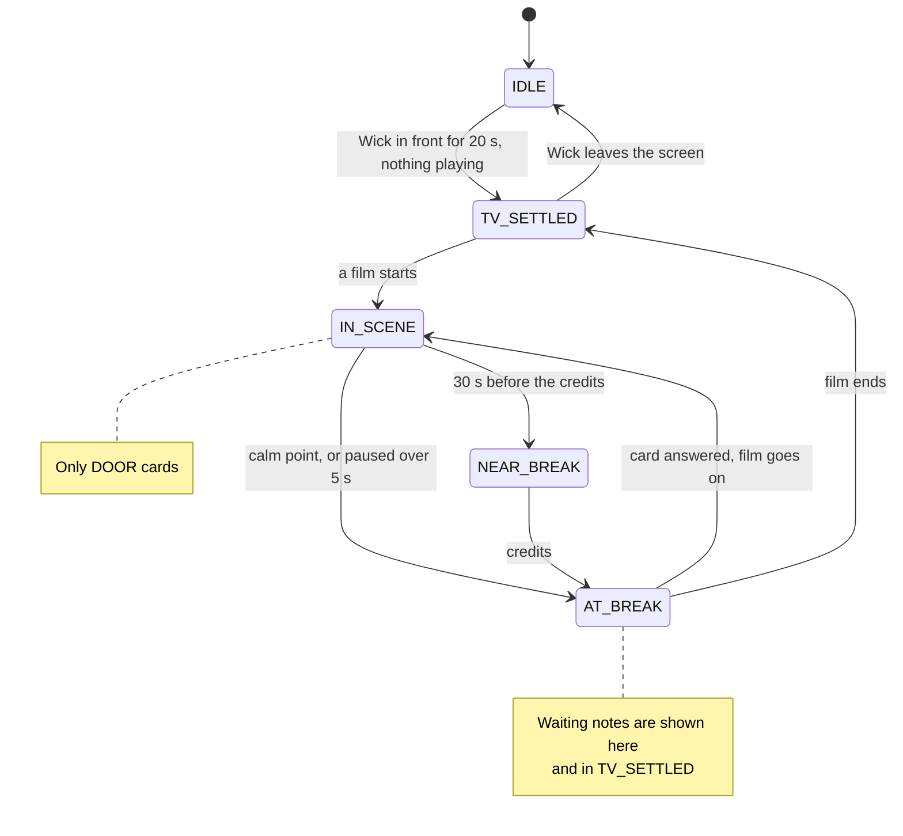

**Release rules.**

1. `DOOR` shows at once, in any state. It never pauses the film or makes a sound.
2. Deferred cards show only `AT_BREAK` or `TV_SETTLED` (INV-5, property-tested).

Wick going behind another app is told to the engine each time it happens, and coming back starts the twenty settled seconds again (`break/followScreen.ts`, on `AppState` through `useOnScreen`). The edge hears `app_lifecycle` `fg` and `bg` with it. On the Vega simulator the app is mounted afresh when it comes back, so this matters most in the seconds before Vega stops a backgrounded app's JavaScript, and on Fire OS, where it can keep running for the door's Headless JS task.
3. A card shown mid-film, at a calm point or in a pause, holds the film on the cut until it is answered. At the credits nothing is held.
4. A card ignored twice waits on the home screen instead of returning. Back on a note puts it there at once (`later`, `home/waiting.ts`): a note's three buttons are replies, so Back is never one of them. The server stamps the note `seenAt` with its two showings (`note-reply.mjs`), so no television brings it back, and the family is told she has seen it, never when (`get_replies`).

**Calm points are measured, never guessed.** `scripts/calm-points` runs Amazon Rekognition segment detection and ffmpeg silence detection over each film and keeps cuts that fall in a quiet stretch. `npm run calm:build` writes `catalog/calmPoints.ts`; nobody edits it by hand. [The published map](https://rogerjeasy.github.io/wick/calm-points/).

**Media controls.** On Vega the film is a media session (`kepler-media-controls`), so the system's transport controls and *"Alexa, pause"* reach it, and each command obeys the same rule as the matching key. On the simulator the system's Stop paused the film and became a break; a spoken command could not be tried, because the simulator takes no voice (FL-031). Fire OS has no media session yet.

### 3.5 Cards and accessibility

Every resident card obeys one floor, enforced at render by `packages/vega-calm-ui` and by lint rules.

| Constraint | Value | Enforced by |
|---|---|---|
| Type | 32 pt minimum | `CalmCard` throws below it; `min-font-size` |
| Contrast | 7:1 minimum | `CalmCard`, tests |
| Actions | 3 at most | `CalmCard`; `max-actions` |
| Colour | No alarm red | `no-alarm-colour` |
| Timers | Nothing auto-dismisses | `no-auto-dismiss` |
| Input | D-pad and OK only | Every flow |
| Settle | No press is taken for 1 s after a card appears | `press/settle.ts` |
| Larger text | Every size × 1.25, floor 40 pt; words stay whole | `calmTheme`, `fitCard` |
| Higher contrast | Pure black and white, 15:1 minimum; 6 dp focus ring | `checkTheme` |

**Easier to see** is one pill on her home screen with three buttons: *Larger text*, *Higher contrast*, *Back*. One provider at the root applies the choice to every screen. It follows the platform's high-contrast setting until she chooses; Vega offers no readable text-size setting (FL-038). With VoiceView on, each card is announced once and the idle slideshow does not start.

**Read to me.** The Play key reads the card on screen aloud in her language, with Amazon Polly, made at the edge and cached a day (`speech.mjs`). A card never reads itself.

**Her language.** Only her press sets it. Wick's own sentences come from a hand-written phrasebook; only free text (a note, the door's sentence, the week) is machine-translated by Amazon Translate, in `egress.ts`, and never stored in the card.

### 3.6 Player

`react-native-w3cmedia` plays HLS. ✅ V. Owning playback is what makes §3.4 possible. The films are Blender Foundation open films (CC BY 3.0), served from CloudFront over HTTPS; the Vega player drops cleartext HLS silently (FL-016).

**Watch together.** After her press on *Start the film*, her player reports its position. The edge keeps only positions that match the session, and only the person who sent the invitation can read them. Their player follows hers, with no pause and no skip.

### 3.7 The Fire OS build

`apps/tv-fireos` has no screens of its own. It bundles `apps/tv-vega/src` with four adapters: `react-native-kepler` to `react-native-tvos`, `w3cmedia` to ExoPlayer, `kepler-file-system` to key-value storage, and media controls to Android's own `MediaSession` (`src/media`, `android/.../media`). The shared session code registers its handler unchanged and each Android command is handed to it by Vega's name, so "Alexa, pause" is a natural break exactly as on Vega. Fire TV's Alexa sends rewind, fast-forward and restart as seeks: a seek to zero is start over, any other a skip by its distance (FL-042). Checked on the emulator with `cmd media_session dispatch`; Alexa itself needs a Fire TV. It runs on the Android TV emulator (API 34), which the hackathon FAQ allows. For the door outside Wick, an Android foreground service runs the shared channel code through Headless JS and posts one high-priority notification. Amazon's guidance says no heads-up over another app; Wick makes that exception for the door only (FL-035). The emulator draws no third-party notifications, so this was checked through `dumpsys` and on a phone emulator (FL-036). Details in [`apps/tv-fireos/README.md`](../apps/tv-fireos/README.md).

### 3.8 Other televisions

- **Her television in a browser tab** (`apps/ops-console/tv.html`) pairs with the same code and gets the same cards. It runs the Vega app's own break rules, bundled from source by `npm run tv:build`. `device.html` is the same television inside an engineers' console.
- **A family member's own television** is the same app connected as *Mine*. Its row is `FTV#`, never `DEV#`, and its token reaches only that member's view (`AGENTS.md` INV-1).

---

## 4. DEVICE ↔ CLOUD

*In short: the television pairs with a six-digit code, then keeps one live connection for cards and presses.*

### 4.1 Transport — both, decided 2026-10-11

A television tries **A** and falls back to **B** (`transport/createDeviceChannel.ts`).

- **A, AWS IoT Core over MQTT/WSS.** A custom authorizer checks the device token and returns a policy for that television's own three topics. The token travels in the URL, not the MQTT password (FL-024).
- **B, API Gateway WebSocket.** The fallback, and the only channel the background services use.

`egress.ts` sends on whichever channel the television's row names. On open, the television asks for the cards it is owed. Seen on the Vega simulator and the Android TV emulator over both channels; not run for hours, across network drops, or on hardware.

### 4.2 Pairing (INV-1, INV-8, INV-9)

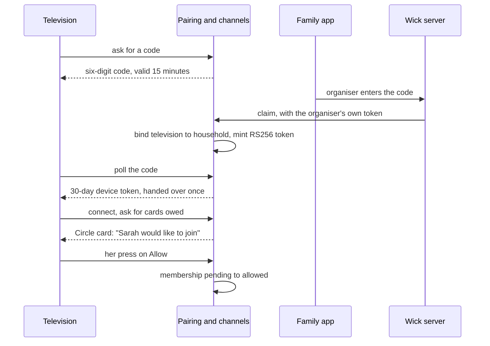

A membership can only move by her press:

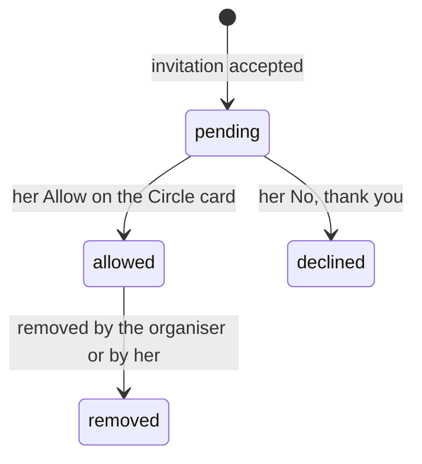

A television that can keep a file also keeps a random secret, and only that secret renews its token (§10.1). The Vega simulator keeps nothing on disk (FL-013), so it re-proves itself through `POST /pair/refresh`, which mints a one-hour token from its id. That is an accepted exception, bounded by time and rate, and allowed in demo homes only: the server refuses to connect a television that keeps no secret to a real home, and refuses its id-only refresh there (`isDemoHome`, `proof.mjs`).

### 4.3 Device → cloud events

```ts
type DeviceEvent =
  | { t: 'playback'; state: PlaybackState; positionMs: number; durationMs: number; contentId: string; at: number }
  | { t: 'break_state'; state: 'IN_SCENE' | 'NEAR_BREAK' | 'AT_BREAK' | 'TV_SETTLED' | 'IDLE'; at: number }
  | { t: 'card_action'; cardId: string; action: string; at: number }
  | { t: 'card_shown'; cardId: string; at: number }
  | { t: 'app_lifecycle'; state: 'fg' | 'bg'; at: number };
```

Exact shapes are in `packages/contracts/src/device.ts`. A press reaches the bus as `wick.device / card.action`, and the agent plane decides what it means.

---

## 5. THE AGENT PLANE

*In short: small agents, each with one job. Two use a model; the rest are rules.*

### 5.1 Graphs and models

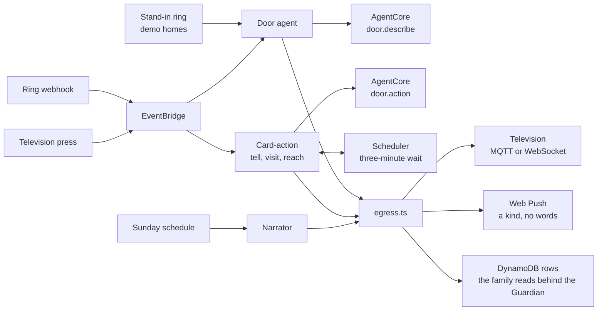

AgentCore Runtime runs one container with four Strands graphs (`services/agent/src/graphs`). The session id is the household, so each household runs in its own microVM.

| Graph | Nodes | Model |
|---|---|---|
| `door.describe` | vision agent, then validate | Nova Lite |
| `door.action` | gate, ring, notify | none: no model decides to make a sound in someone's home |
| `live.start`, `live.stop` | gate, bridge | none |

| Job | Model | Why |
|---|---|---|
| Door picture to one sentence | Nova Lite | Fast and cheap; it describes, it does not reason |
| Weekly narrative | Claude Sonnet 4.5 | Prose quality is the product; runs once a week |
| Family app: which tool answers | Claude Sonnet 4.5 | Choosing among 26 tools; it only words what a tool returned |
| Guardian | none | Rules only |

### 5.2 Door agent

The card never waits for the slow parts.

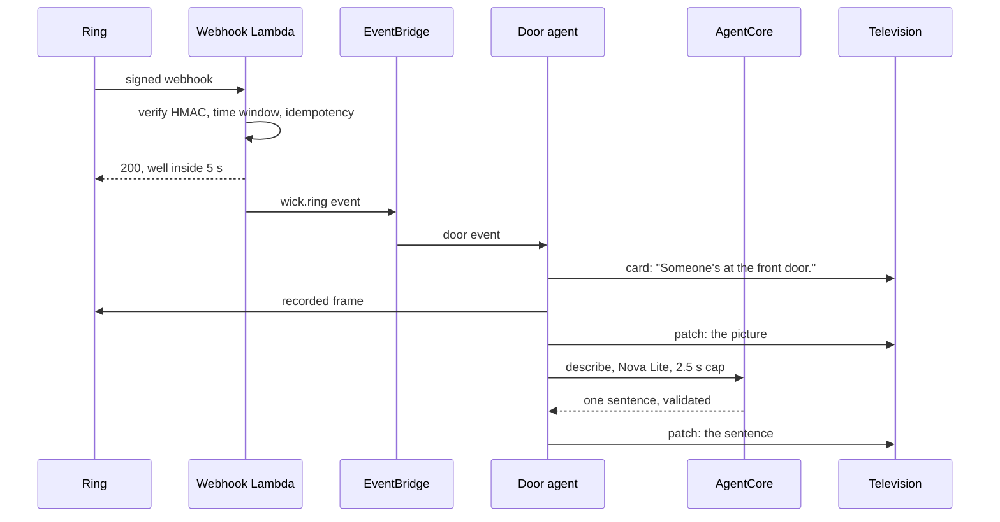

- **Phase 1 has no picture** because Ring has no live-capture call; its recorded frame took 3.15 s (SP-2, FL-005).
- **The description is cancelled at 2.5 s.** A late sentence is worse than none.
- **The sentence is constrained** in the prompt and by a validator (`door/index.ts` `descriptionRefusal`): one sentence that opens as a description, twelve words asked for and at most 16 allowed, no speculation, no name, no second person, no number, no quoted text, nothing the family Guardian would refuse, and never the prompt's own example given back. The model's `UNCLEAR` is the only abstention; no confidence number is claimed, because none was measured. Measured on 42 tries over film stills, including cards of injected text: nothing unsafe was shown ([`docs/evals/door-descriptions.md`](evals/door-descriptions.md), `npm run eval:describe`).
- **Roster matching is by schedule**, never by face ("Maria usually comes on Tuesdays at nine").
- **Buttons.** *Watch live* bridges Ring's WebRTC to HLS for her player. *Ring the hallway chime* is built and contract-tested, but the Playground has no chime, so it is not in the demo (FL-019). *Ask Sarah to look* writes a row for the family's tools and sends a push that carries no words.
- **The stand-in doorbell.** The Playground sends no webhooks (FL-027), so a demo home can ring a stand-in from the family app. Only the Wick server may send it, the agent checks the home is a demo home, the pictures are made up ([`docs/demo-door/NOTICE.md`](demo-door/NOTICE.md)), and every row is marked `simulated`.

Measured from the stand-in to a television: card 2.3 s, picture 2.7 s (§9.1).

### 5.3 (removed)

The Day agent was removed with its data source. The number is kept so references stay valid.

### 5.4 Narrator — and why it is precomputed

A week cannot be written inside a 500 ms tool call, so it is written ahead.

- Every Sunday at 20:00 UTC, for each household with a television.
- Code counts the week and compares it with the household's own baseline; Claude Sonnet 4.5 writes prose from those numbers. **The model never counts.**
- The week goes to her television first; the family's tool reads nothing until her press sets `residentSeenAt` (INV-7).
- `get_week_narrative` is one DynamoDB `GetItem`.

A demo home's six weeks are written as the Door agent's own rows and counted by the Narrator's own code, marked `simulated`.

### 5.5 Prompts

The prompts are constants beside the code that calls them (`door/describe.ts`, `narrator/prose.ts`). Every reply passes a validator before use. `services/agent/prompts/` holds early briefs and is not loaded at run time.

### 5.6 Something's Different, and "Shall I tell Sarah?"

`rhythm/different.ts` compares a day with the household's own last six weeks: a regular visitor who did not come, someone at the door in a house that never has night visitors, a day unlike that weekday. Nothing is called different from fewer than three weeks. Pure code.

**A quiet door and a door Wick could not see look the same, so they are kept apart.** Every event from a household's doorbell, a car going past as well as a visitor, marks its hour as heard (`packages/contracts/src/heard.ts`, one `HEARD#<UTC day>` row holding the hours, kept 60 days). Anything said from an absence needs the doorbell heard on both sides of the stretch it is about: "nobody came when Maria was expected", "quieter than usual". A past week with an unheard day leaves the baseline. After six hours without a word from the doorbell, the detector says so (`doorUnheard`) instead of reporting an empty day. The week names its unheard days (`WeekNarrative.unheardDays`), drops every comparison an absence would make, and the Narrator refuses a draft that calls such a week quiet (`unheard_absence`).

A difference is never sent to the family. Her television asks *"Shall I tell Sarah?"* with the exact sentence, and only *Tell* writes the row the family's tool reads (INV-10).

### 5.7 The visit, witnessed

The first sighting of a regular visitor opens a visit; the last sighting before she is asked closes it. At a natural break her television asks *"Is this right?"*. Only her *Yes* confirms. To the family, unasked, waiting and disputed look the same.

### 5.8 Hold for Sarah

OK held for two seconds offers *"Ask Sarah to ring you?"*. Her press asks one person. A one-time EventBridge Scheduler schedule fires three minutes later, re-reads the circle and asks the next person, a neighbour last. The schedule carries a request and a step, never a name. Wick calls nobody and sounds nothing.

### 5.9 egress.ts

The single exit (INV-2): `sendToDevice` over MQTT or WebSocket, `nudgeFamily` over Web Push with no words, and the Translate call. A lint rule keeps those clients out of every other module.

### 5.10 Prompt-free features

The light, watch together, the mantelpiece, waves and read-to-me use no model. They are edge handlers and Wick-server routes with rules in `packages/contracts` and `AGENTS.md`.

---

## 6. THE GUARDIAN

*In short: before the family reads anything, a rules engine checks it. If it mentions health, money, relationships or location, it is held back, and held back in a way that gives nothing away.*

### 6.1 Shape

A pure package, `services/policy`: no AWS, no network, no model.

- **`evaluate(item, audience, policy)`** decides by class: may this kind of fact reach this audience?
- **`clearForFamily(text)`** decides by content. It folds the text to plain letters, reads it with a hand-written lexicon (`lexicon.ts`), and asks `evaluate` about every class it finds. Text it cannot read (another script, look-alike letters, invisible characters, emoji) is not cleared.

```ts
type FactClass = 'DOOR_EVENT' | 'PRESENCE' | 'COMMITMENT' | 'RHYTHM'
               | 'HEALTH' | 'FINANCIAL' | 'RELATIONSHIP' | 'LOCATION' | 'VERBATIM';

function clearForFamily(text: string, policy?: HouseholdPolicy):
  | { cleared: true; text: string }
  | { cleared: false; classes: FactClass[] };
```

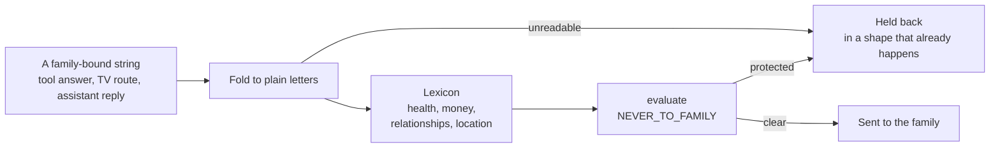

`VERBATIM` needs no lexicon entry: her television has no microphone, and her replies are keys to sentences Wick wrote.

### 6.2 The default policy table

| Class | Resident | Family | Agency |
|---|---|---|---|
| `DOOR_EVENT`, `PRESENCE` | allow | allow | own visits only |
| `RHYTHM`, `COMMITMENT` | allow | summarised only | deny |
| `HEALTH`, `FINANCIAL`, `RELATIONSHIP`, `LOCATION` | allow | **never** | deny |
| `VERBATIM` | allow | **never** | deny |

A family opt-in can widen a class, but never one in `NEVER_TO_FAMILY`. Her exclusions apply after the table and can only narrow.

### 6.3 Enforcement

The gate stands where the family reads: on the Wick server.

- **Every MCP tool** is registered on the one server through `guardTools`, which reads every string in every answer before it leaves.
- **Every family-television route** answers through `guardTelevision`.
- **The assistant's reply** is checked in `checkReply`; one it cannot clear is replaced by the tools' own sentences.
- **Holding back says nothing.** A door sentence it cannot clear is left out, as when the vision model was unsure. A week it cannot clear is told from its counts. A note's words go back only to their writer.
- **Tests.** `guardian.test.ts` holds that every tool is behind the gate and there is only one server. Property tests put every lexicon phrase, in any case and disguise, through the real tool server, the television routes and the assistant; the policy package adds 10,000 cases over the lexicon and over `evaluate`. CI runs them as their own job.

Her own television is not gated: everything on it is about her.

### 6.4 Refusal is a feature

When she has chosen to keep a whole class private, the family is told plainly and kindly: *"That's something Margaret's keeping to herself."* Silence would look like "nothing happened", which is untrue.

The content gate works the other way: saying "something was held back" would reveal that it was about her health, so it holds back silently, in a shape that already happens.

### 6.5 What the gate cannot do

A lexicon catches what it lists. "St Mary's" or "d0ctor" pass. It stops Wick passing a protected fact on by accident; it does not stop someone set on spelling one past it. A missed word is added with a test, and so is the ordinary sentence it must not catch. It also fails closed: "a man on crutches" loses its sentence.

**Names in other scripts.** The lexicon is English and reads letters a–z, so a letter outside them used to withhold the whole string. That made a household whose resident, carer or daughter is written in Cyrillic, Greek, Hebrew, Arabic, Han, Hangul or an Indic script unusable: every sentence that named her was withheld, and every answer was "Something went wrong". One exception now exists, and it is narrow (`services/policy/src/foreign.ts`):

- A *word* wholly in one other script may stand as a person's name, unless it says doctor, nurse, hospital, medicine, bank, pension or debt in that script. A word with letters of two scripts is the look-alike trick and is still unreadable, as is an invisible character or an emoji.
- Inside a sentence, such a word is set aside only where the household's own people are given (resident, home label, regular visitors, circle: `services/mcp-server/src/people.ts`, read only when an answer would otherwise be withheld). The rest of the sentence is read as before, so "Мария saw the doctor" is still held back.
- A Latin name is never set aside inside a sentence, as before.
- A person in another script is filed under `u-` and a 64-bit fingerprint of the name (`packages/contracts/src/person.ts`); it used to be an empty id, which the roster refused.

What this does not do is read those languages. The role-word lists are short, hand-written, and best effort. A health word the lists do not hold, in a script the gate cannot read, typed by a family member as a visitor's name, would be accepted as a name: the household's own circle chose that name for someone in it, and no model or sensor of hers is behind it. Sentences in another script that are not a vouched-for name (a door sentence a model wrote in Russian, say) are still withheld.

---

## 7. CONNECTORS

*In short: Ring is reached server to server with per-household tokens; the family is reached through a standard MCP server.*

### 7.1 Ring

- **Auth.** OAuth 2.0 with PKCE. ✅ V. All calls are server to server; Ring blocks browser origins.
- **Custody.** Each household's tokens are one Secrets Manager secret, and there is no Ring client without a household. A link is finished only for the organiser who started it. One Lambda owns refresh.
- **Webhook receiver** (`webhook-receiver.mjs`, 33 tests). It does five things and nothing else:

```
1. Verify X-Signature (HMAC-SHA256 of the raw body, constant time)      else 401
2. Read Ring's v1.1 envelope                                             else 400
3. Drop a body sent over 5 min ago or 1 min ahead (meta.time)            200, nothing on the bus
4. Idempotency on meta.request_id (conditional write, 24 h)              duplicate: 200
5. Put the event on the bus, return 200
```

Failures to read the key, write or publish return 500 so Ring retries. A stale body is answered 200, not 4xx, because Ring counts repeated 4xx toward disabling an endpoint (FL-041). A ring takes its household from the doorbell (`RINGDEV#`), and a device nobody holds reaches no one (INV-8).

| Purpose | Call |
|---|---|
| Discovery | `GET /v1/devices` |
| Picture | `POST /v1/devices/{id}/media/image/download`: a recorded frame, 3.15 s |
| Watch live | `POST /v1/devices/{id}/media/streaming/whep/sessions` |
| Hallway chime | `POST /v1/devices/{chimeId}/media/audio/playback` |

**The Playground**, Ring's only simulator, gives a simulated camera behind the real API. It has no chime (FL-019), sends no webhooks (FL-027), and its token lasts 30 minutes (FL-010).

### 7.2 (removed)

The wearable connector was removed. The number is kept.

### 7.3 The Wick server: MCP endpoint (S4a) and the Alexa+ add-on (S4b)

| | Status |
|---|---|
| **The MCP server** | Built and deployed on App Runner. Exercised by MCP Inspector and the family app. |
| **Alexa+ registration** | Partner-gated (FL-001). `addon-package/addon.json` is complete and checked by `npm run addon:check`; it has not been, and cannot be, uploaded. |

**What the server is.**

- MCP **2025-11-25** over **Streamable HTTP**, stateless: each request gets a server for the person its token names; nothing is held in memory between requests.
- Its own **OAuth 2.1** authorization server (PKCE, dynamic client registration). **Cognito** decides who someone is.
- Tokens are bound to this server (RFC 8707); `401` carries no `WWW-Authenticate`, as Alexa's quickstart asks.
- Every tool declares an **output schema**, and a write sent twice acts once (`tools/once.ts`).
- Every tool runs inside `gated`: household from the token (INV-8), her allowance checked on every call (INV-9).
- No tool calls a model.
- One esbuild bundle on plain Node, with `GET /health`, a `Server-Timing` header and a drained stop on SIGTERM.

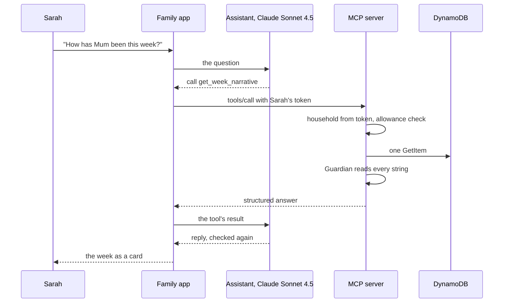

**The 26 tools.**

| Area | Tools |
|---|---|
| The week and today | `get_week_narrative`, `get_today`, `get_resident_shared_view`, `get_whats_different`, `get_light` |
| Visitors | `did_visitor_come`, `get_visits`, `list_regular_visitors`, `add_regular_visitor`, `expect_visit` |
| Visit errands | `arrange_visit`, `get_errands`, `cancel_errand`, `make_visit_pass` |
| Notes | `send_note_to_tv`, `get_replies` |
| The door | `get_door_request`, `answer_door_request` |
| Being asked to ring | `get_reach_request`, `answer_reach_request` |
| Watching together | `invite_to_watch`, `get_watch_together`, `answer_watch_together`, `join_watch_together`, `withdraw_watch_invitation` |
| Pictures | `get_pictures` |

A neighbour may use only the door and ring tools.

**What the visitor tools may say.** The door knows *when* somebody rang, never *who*: a courier during the carer's hour writes the same row as the carer. So every tool, timeline and weekly story keeps three things apart (`packages/contracts/src/visit.ts`):

| State | Where it comes from | How it is said |
|---|---|---|
| Expected | The roster: a day and a time, or a visit somebody announced | *"Maria is usually expected on Tuesday mornings."* |
| Door when expected | A `presence` row: somebody at the door in that window | *"Someone came to the door when Maria was expected."* |
| Confirmed | A `VISIT#` row she answered *"Yes, that's right"* to | *"Maria came, as confirmed on the television."* |

`did_visitor_come` answers `confirmed` and `doorWhenExpected` separately and has no plain `visited`. `list_regular_visitors` gives `lastConfirmedVisitAt` and `lastDoorWhenExpectedAt`. The Narrator refuses a model draft that says an unconfirmed visitor came (`unconfirmed_visit`), and a week stored in the old words is read again from its counts.

**The family app** (`apps/sim-alexa`) signs in to a real account; *Try the demo* makes you Sarah in a demo home. Tool results appear as cards in the Alexa+ design guide's vocabulary, with a carousel for the week. A family member can also ask by voice: one utterance of up to ten seconds goes to Amazon Transcribe and is asked as if typed; nothing is kept.

### 7.4 Other AWS services, by feature

| Service | Used for |
|---|---|
| Rekognition | Checking a family picture before it is sent; measuring calm points |
| Polly | Read to me |
| Translate | Free text into her language |
| Transcribe | Ask by voice, in the family app |
| EventBridge Scheduler | The three-minute wait in Hold for Sarah |
| IoT Core | The television's MQTT channel |
| Cognito | Family sign-in |

---

## 8. DATA MODEL

*In short: one DynamoDB table, keyed by household, so every read is scoped to one home.*

### 8.1 DynamoDB — single table `wick`

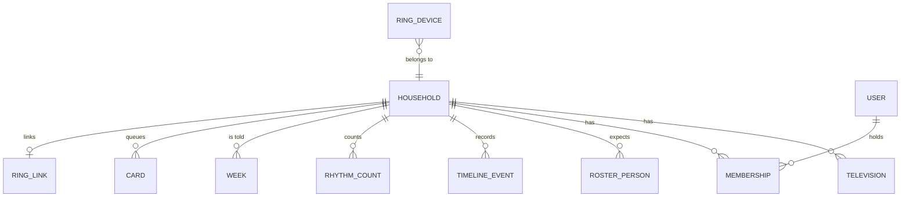

| Entity | PK | SK | Notes |
|---|---|---|---|
| Household | `HH#<id>` | `META` | language, policy, `timeZone`, `simulated` for a demo home |
| Her television | `HH#<id>` | `DEV#<deviceId>` | channel, last seen |
| A family member's television | `HH#<id>` | `FTV#<deviceId>` | the member's id; never counted with `DEV#` |
| Membership | `HH#<id>` | `MEM#<userId>` | role; `pending` until she allows (INV-9) |
| Roster person | `HH#<id>` | `PER#<personId>` | name and usual days; never a face |
| Timeline event | `HH#<id>` | `EVT#<ts>#<id>` | door, presence, cards |
| Rhythm count | `HH#<id>` | `RHYTHM#…` | counts by weekday and hour |
| Card | `HH#<id>` | `CARD#<id>` | queue state, showings |
| Week | `HH#<id>` | `NARR#<isoWeek>` | `residentSeenAt` gates the family (INV-7) |
| Feature rows | `HH#<id>` | `LOOK#`, `TELL#`, `VISIT#`, `REACH#`, `WATCH#`, `LIGHT`, `PHOTO#`, `MANTEL#`, … | one prefix per feature; rules in `AGENTS.md` |
| Account, OAuth state | `USER#…`, `OAUTH#…` | … | Cognito holds passwords |
| Pairing code | `PAIR#<code>` | `META` | 15-minute TTL |
| Ring device holder | `RINGDEV#<deviceId>` | … | which home a doorbell belongs to |
| Webhook idempotency | `IDEM#<requestId>` | `META` | 24-hour TTL |

**Where the house is.** Each home keeps its own IANA time zone (`timeZone` on `META`, `packages/contracts/src/clock.ts`). It is given when the home is set up: the family app sends its browser's zone with `/authorize`, the set-up page fills it in to be corrected ("Their time zone"), and a demo home is lived on the guest's own clock. Every day, "this morning", visit time, light and week of a home is read in it, on the server, the agents and the edge. A home set up before homes had one is read in `Europe/London`.

### 8.2 The Rhythm

Counts in DynamoDB, not a time-series database. Each door event and television session increments a bucket by weekday and hour. The baseline is the household's own last six weeks, and **nothing is called different from fewer than three weeks**. A false alarm is worse than none.

### 8.3 S3

| Bucket or prefix | Contents | Kept |
|---|---|---|
| media `snapshots/`, `live/`, `tts/` | Ring frames, live segments, readings | **1 day** (INV-3, by lifecycle rule) |
| photos | The family's pictures | deleted a day after she lets one go |
| programmes, family app, console | Films and static pages | kept |

### 8.4 Withdrawal

Members can be removed and televisions disconnected; each takes effect on the next call. A person can export and delete their own data; deleting an organiser closes the home. A one-call "delete this household" for operators is not built (§17).

---

## 9. PERFORMANCE

*In short: the door reaches the screen in about two seconds, and the server's own work is under 20 ms.*

### 9.1 The door

| Segment | Result |
|---|---|
| Stand-in ring to card on a television | **2.31 s** median, 2.56 s max (5 rings, 16 October, `npm run latency:door`) |
| To the picture | **2.70 s** median |
| To the vision model's sentence | **2.86 s** median; 1 of 5 rings got none |
| Ring's recorded frame | 3.15 s (SP-2) |
| Vision description | cancelled at 2.5 s |
| A real Ring press, end to end | Not measured: the Playground sends no webhooks |

### 9.2 The television app

Not instrumented with Vega's performance tools (§17). Held by tests: the break engine's decisions, the one-second settle, and that a deferred card never shows `IN_SCENE`.

### 9.3 MCP latency

Alexa+ asks for under 500 ms. ✅ V. Measured on the deployed image `3ca74bf`, 16 October, from a laptop in Europe (`npm run latency:mcp`):

| Measurement | p50 | p95 | Over 500 ms |
|---|---|---|---|
| The server's own work (`Server-Timing`) | 11 ms | 18 ms | none |
| Calls on an open connection | 192–196 ms | 230–241 ms | none |
| All calls, back to back (100) | 196 ms | 315 ms | 3 |
| All calls, one a second (120) | 193 ms | 732 ms | 7 |

Every slow call opened a new connection: App Runner's front end closes idle connections after 2–51 s, and a new TLS connection from Europe costs 0.5–0.8 s (FL-033). The fix is a keep-alive layer in front of App Runner or another host, not server code. These guest calls stop at the access check, so they measure everything except a tool's own reads. Figures in issue [#47](https://github.com/rogerjeasy/wick/issues/47).

---

## 10. SECURITY

*In short: no long-lived secret on any device, every request scoped to one home, and every family-bound word checked.*

### 10.1 Credential map

| Secret | Lives in | On a device? |
|---|---|---|
| Ring tokens | Secrets Manager, one secret per household | Never |
| AWS and Bedrock | IAM roles; no static keys | Never |
| Device token | The television | Yes, scoped to one home's cards and presses; it records how it was earned |
| Device secret | The television; the server keeps only its SHA-256 | Yes; it renews that one token. Made by a cryptographic generator, never `Math.random` |
| Device id | The television; the table | A label, not a secret; never sent to the family app or logged |
| Pairing code | The screen; 15 minutes | Used once |

### 10.2 Threat model, briefly

| Threat | Control |
|---|---|
| A stolen Fire TV | Its token reaches one home's cards and nothing else. The organiser disconnects it, and every path refuses it. |
| A copied device token | Expires in 30 days (1 hour from a refresh); where the television keeps a secret, it cannot be renewed without it. |
| Someone who knows a television's id | Refresh requires the secret, compared in constant time. **Open:** the Vega simulator keeps no secret and its id is fixed, so it is only paired to demo homes (`AGENTS.md` INV-1). |
| Someone who reads the table | Finds hashes, not secrets. |
| A guessed pairing code | Worthless until the organiser, signed in, enters it; then used once. |
| A forged or replayed Ring webhook | HMAC-SHA256 over the raw body; a time window on `meta.time`; idempotency on `request_id`. |
| Prompt injection through a note or a visitor's clothing | The Guardian runs after every generation, by rules. A model talked into writing a health fact still cannot get it past. |
| A family member overreaching | Policy table and her exclusions; exclusions only narrow (§6.2). |
| A replayed press | Single-use card ids, server-side counts, idempotent actions. |
| Logs leaking ids | A test reads every logger call and fails on a device id. |
| An anonymous visitor running up the bill | The allowances a guest spends (assistant steps, spoken questions, demo guests) are counted in the table, `LIMIT#…` rows with a window and a `ttl`, so every instance and every restart reads one count (`services/mcp-server/src/budget.ts`); App Runner may scale to `mcp_max_instances` (default 2), not 25; and when the month's actual spend passes the budget, AWS Budgets attaches a deny of Bedrock and Transcribe to the three roles that call them (`infra/budget.tf`) until someone lifts it; the deploy role can read the brake and cannot change it. A table that cannot be asked allows nothing. |
| A flood of one public route starving Ring's webhook | Each route of the edge API has its own throttle (`edge_route_limits`), the webhook's the largest, and the webhook function has reserved concurrency of its own (`infra/edge.tf`). |
| Anyone who can merge to `main` reading a household | The deploy role holds the verbs Terraform needs on `wick*` names, and an explicit deny of item and object access, function invocation, event sending and log reading for the whole account (`infra/github-oidc.tf`; checked against 20,000 recorded CI calls and 78 allow/deny cases in the IAM policy simulator). It does **not** stop a merged change from deploying code that the functions' own roles run: that is what review and the protected branch are for. Accepted exposure: the role may list the names in the door-picture and family-photo buckets (`photos/<household>/<random id>.jpg`), because Terraform's `HeadBucket` check needs `s3:ListBucket` and a refresh refused it once read both buckets as deleted (CI, 2026-10-19). That says which homes hold pictures and how many, not who is in them; reading, writing, deleting and listing past versions stay denied. |

### 10.3 `AGENTS.md`

[`AGENTS.md`](../AGENTS.md) encodes the invariants as rules for anyone, or any coding agent, working in the repository, with the files and tests that enforce each.

---

## 11. OBSERVABILITY

- **Correlation id** (INV-6) from the webhook or MCP request through the bus, the agent, its rows and the card.
- **Logs** in CloudWatch with retention set in Terraform. No request bodies, no device ids, no spoken words.
- **Alarms** (`alarms.tf`) on every Lambda's errors and throttles, the door path's dead-letter queue, the narrator, App Runner and both APIs, sent to an SNS topic that emails the address in the `ALARM_EMAIL` repository secret.
- **Live smoke test** (`npm run smoke:live`) after every deploy and nightly: health, security headers, OAuth metadata, a fresh guest, every tool listed, account export and deletion.
- **Health report** for operators only (`npm run ops:status`, the status Lambda invoked with their own AWS credentials): it names the operator's household and the age of its Ring token, so it has no public route. Custom metrics and dashboards are not built (§17).

---

## 12. TESTING

*In short: about 6,000 automated tests, the television's screens rendered by React itself, property tests on the two rules that matter most, and live checks against the deployed stack.*

### 12.1 Real and simulated, resolved

| Layer | Rule |
|---|---|
| Unit and property tests | Fixtures are expected; they live under `__tests__` and never ship |
| The running product | No mock is reachable: `npm run check:no-mocks` fails the build otherwise. It reads every import the way TypeScript does (`ts.preProcessFile`), so named, re-exported, bare, dynamic and `require` imports are all caught |
| The demo | Simulated devices and a marked demo home; everything between is the deployed stack |

`npm run verify` runs typecheck, lint, the no-mocks guard and every test. CI runs it on every pull request, with the property tests as a separate job; `main` requires both.

### 12.2 Natural-Break Engine

Synthetic playback timelines, with fast-check: no deferred card ever shows `IN_SCENE`; `DOOR` shows in any state; a card shown mid-film holds it until answered.

### 12.3 Guardian

Property tests over `evaluate` (no protected class reaches the family under any policy), over the lexicon (no listed phrase is cleared, however written), and through the real tool server, television routes and assistant.

### 12.4 Model output

Each model reply passes a tested validator. A reply that fails is dropped: the door card keeps its first sentence, the week keeps its counted facts.

### 12.5 Contract tests

Ring responses recorded from the Playground, redacted and replayed; the chime tested against Ring's documented contract for every outcome; every tool called over HTTP and validated against its output schema; INV-8 held by server, API and pairing tests.

### 12.6 Device testing

No physical Fire TV or Ring device. Live checks ran on the Vega Virtual Device, the Fire OS build on the Android TV emulator, and the browser television, against the deployed stack ([`docs/screenshots/`](screenshots/)). Legibility at three metres, a real panel's contrast, and sound have not been checked.

### 12.7 The television's screens

Every Vega screen is rendered in tests by React's own reconciler (`react-test-renderer`), with its hooks, effects and state running; only the platform's components, the disk and the media player stand in (`apps/tv-vega/src/__tests__/render`). Every card type is drawn in all four Easier to see settings and in English and Spanish, and held to the calm limits: no more than three labelled buttons, one header, nothing under 32 pt, and 7:1 contrast (15:1 in higher contrast). The home screen, pairing, live view, the idle screen and the Easier to see card are drawn too, and `ResidentApp` is drawn whole, with its real queue, break engine and one-second look: a door card comes over a film, a note waits for the credits, and nothing but the door is shown while Wick is behind another app.

---

## 13. BUILD, DEPLOY, EXTRACT

### 13.1 Infrastructure

Terraform (≥ 1.10, AWS provider ~> 6.0), one root in `infra/`, state in S3 with native locking, one file per concern. Stateful resources carry `prevent_destroy`. The first apply, and any change to the deploy role, runs from a laptop. See [`infra/README.md`](../infra/README.md) and [`docs/SETUP.md`](SETUP.md).

### 13.2 CI

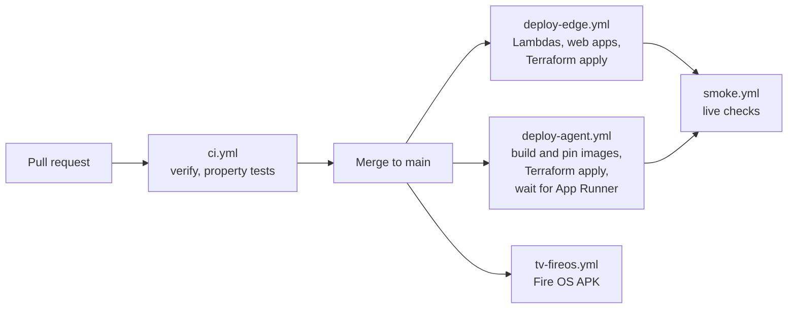

GitHub Actions authenticates to AWS over OIDC; there are no static keys. Images are tagged with the commit and pinned in SSM, so a deploy is reproducible and a rollback is one pin. The Vega `.vpkg` is built with the Vega SDK on a developer machine; CI does not build it.

### 13.3 Environments

One deployed stack, used for every live check. It holds only test and demo homes; there is no real household on it.

### 13.4 The Open Source extraction

`packages/vega-calm-ui` (MIT) is an accessible 10-foot component set for Vega: cards that refuse to render below the type and contrast floor, a two-phase card that reserves its space, larger-text and high-contrast themes, screen-reader and reduced-motion hooks, and four ESLint rules. Its own repository is <https://github.com/rogerjeasy/vega-calm-ui>, and it is on npm (`npm install vega-calm-ui`): 0.1.0 to 0.1.2, published on 2026-10-16 by the repository's release workflow with provenance, the last through npm's trusted publishing with no token stored anywhere.

---

## 14. THE SPIKES, AND WHAT THEY FOUND

| # | Question | Answer |
|---|---|---|
| **SP-1** | Can anything appear over another app? | No overlay, but a background service can post a system toast on Vega (FL-022, FL-026). On Fire OS, a foreground-service notification (FL-035, FL-036). |
| **SP-2** | How fast is a Ring picture? | 3.15 s, and it is a recorded frame, not live (FL-005). So the card ships first. |
| **SP-3** | Ring live view on Vega? | Vega has no WebRTC (FL-015). Bridged to HLS in a Lambda, since AgentCore has no outbound UDP (FL-017). |
| **SP-4** | Alexa+ add-on access? | Partner-gated (FL-001). Built to spec, exercised through the family app. |
| **SP-5** | MQTT inside Vega's React Native? | Works, with a WebSocket fallback. |
| **SP-7** | Content Personalization to Continue Watching? | Reports are taken by the platform on the VVD (§3.3). Continue Watching needs a catalogue integration Wick does not have (FL-043). |
| **SP-8** | A Vega build on real Fire TV hardware? | Not run; the simulator is the evidence the rules allow. |

---

## 15. BUILD ORDER, AS IT HAPPENED

| Step | Built |
|---|---|
| 1 | The door card: webhook to bus to agent to television |
| 2 | The MCP server, then accounts, Cognito and the family app |
| 3 | The Guardian, egress, the lint rule, property tests |
| 4 | The natural-break engine, then calm points and the hold |
| 5 | The rhythm: counts, the six-week baseline, the three-week floor |
| 6 | Chime, Watch live, one-button reply, known visitors, the visit witnessed |
| 7 | "Shall I tell Sarah?" and "What Sarah sees" |
| 8 | The Fire OS build and the browser television |
| 9 | The twelve features in the README, each with its rules in `AGENTS.md` |

---

## 16. OPEN TECHNICAL QUESTIONS

| # | Question | State |
|---|---|---|
| **Q1** | Can a Vega app draw over another app's playback? | Answered: no; a system toast, yes (SP-1) |
| **Q2** | Are Ring WHEP sessions limited? | 30 s battery, 60 s wired; concurrency untested |
| **Q3** | MQTT over WSS on Vega? | Answered: yes (SP-5) |
| **Q4** | Does `kepler-file-system` protect data at rest? | Undocumented; assumed plaintext, and the token is scoped for that |
| **Q5** | AgentCore Gateway or a custom MCP server? | Answered: custom, because Alexa+ needs its own OAuth server |
| **Q6** | Audio ducking? | Not pursued; Wick plays sound only when she asks |
| **Q7** | Accessibility preferences on Vega? | Reduced motion, screen reader and high contrast, yes; text size, no (FL-038) |
| **Q8** | Most legible MCP client for the demo? | The family app |
| **Q9** | Why is the deployed MCP server two-speed? | Answered: new connections from Europe, closed by App Runner (§9.3) |

---

## 17. CONSIDERED AND NOT BUILT

| Idea | Why not, or what replaced it |
|---|---|
| Amazon Timestream for the rhythm | DynamoDB counts were enough |
| Bedrock Knowledge Bases | No free-text facts are stored to recall; fixed tools answer |
| AgentCore Memory, Identity, Gateway | The table is the memory; Ring tokens are in Secrets Manager; the MCP server is custom (Q5) |
| SQS FIFO per household, an EventBridge archive | One dead-letter queue on the door path, with an alarm |
| Custom metrics and dashboards | Latency measured by script (§9); alarms are built |
| The week as an MCP Apps panel | The family app draws its own week card |
| A one-call household deletion for operators | Members and televisions are removed individually; people can delete their own accounts |
| Voice notes from the family | Transcribe is used only for spoken questions |
| Replies written by a model | Replies are chosen from sentences Wick wrote |
| A model in the Guardian | Rules only, by design |
| Face matching for visitors | Rejected: schedule only |
| Testing on Fire TV hardware | The simulators, then a real Fire TV Stick 4K Select (Vega OS) |

---

## 18. THE FAMILY ASSISTANT AS AN AGENT

*In short: the family's assistant is a Strands agent on Bedrock AgentCore Runtime. It calls Wick's own MCP tools with the family member's own token, pauses for the member's yes before every write, and keeps the conversation in AgentCore Memory.*

The family app asks `POST /assistant/turn` on the Wick server. The server checks the member's token and the resident's permission (INV-8, INV-9) and invokes the AgentCore runtime (`InvokeAgentRuntime`, kind `assistant.turn`) with a runtime session that is that member's in that home (`assistant-<sha256(home:member)>`). The token travels in the payload and is never logged, stored or returned.

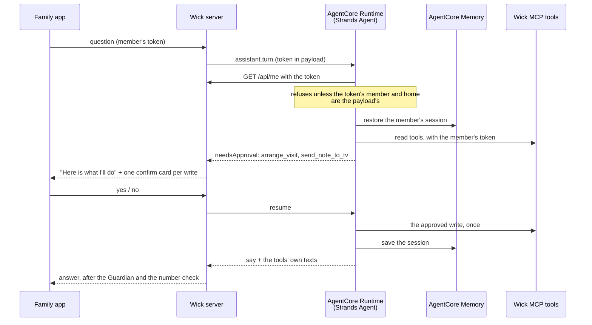

**One turn** (`services/agent/src/agents/assistant/turn.ts`):

1. **Who.** The token is checked against the Wick server (`GET /api/me`, `verify.ts`) before anything else. Unless the token's member and home are the ones in the payload, the turn answers `unauthorized`: no session is loaded, no model is called, no tool runs. The runtime is shared with the door's kinds, so the payload is not trusted.
2. **The agent.** A Strands `Agent` on Claude Sonnet 4.5, its tools from `McpClient` pointed at Wick's MCP server with `Authorization: Bearer <member token>`. Every rule the tools enforce applies to it: it can do nothing the member could not.
3. **Writes wait for a yes.** A `BeforeToolCallEvent` hook interrupts any tool whose MCP annotation is not `readOnlyHint: true` (`approval.ts`). The turn returns the waiting calls; the app shows them on the confirm cards it has always used; the member's answer resumes the agent with `InterruptResponseContent`. One yes covers exactly one call (`hook:beforeToolCall:<toolUseId>:approve`). A declined call gets a "declined" result.
4. **Limits.** At most four calls in a round and six rounds in a turn, 20 seconds.
5. **The answer.** The Bedrock Guardrail reads it first, grounded in what the tools returned (§20); a reply it refuses is not said. A reply that called no tool, such as a clarifying question, has nothing to ground on. The assistant names it as one that may stand without facts, so its topics and filters still read it. Every other check refuses a sentence that has no facts under it. Then the server passes it through the Guardian and the same number check the old assistant used, against what the tools said: the model chooses words but cannot add a fact.

**Sessions.** A Strands `SessionManager` saves the conversation after each invocation, including a write paused for the member's yes, into AgentCore Memory through `packages/strands-agentcore-session`. That is the code of Wick's open-source pull request to `aws/bedrock-agentcore-sdk-typescript` (#287), which answers that repository's issues #160 and #214; its five integration tests pass against a real AgentCore Memory. A member's conversation survives a cold start of the microVM and a new browser. It is filed under the agent's own actor id, apart from the long-term records.

**Long-term memory.** A `MemoryManager` over the official `AgentCoreMemoryStore` (`bedrock-agentcore`), with a user-preference strategy under `/households/{home}/members/{member}`. It remembers the member's own words ("our plumber is Dave"), never what a tool said about her.

**Fallback.** When the runtime is not configured or fails, the route answers 503 and the app uses the previous assistant (`/assistant/next`), unchanged. A failure after a yes is reported, never retried by the old path, so nothing is done twice.

**Deleting an account** deletes the member's AgentCore Memory too: their conversation events and their long-term records (`services/mcp-server/src/assistant/forget.ts`).

## 19. VISIT ERRANDS

*In short: "The plumber is coming Thursday at ten — let Mum know" is carried out over days by a Step Functions workflow: the door is told whom to expect, she is reminded on the morning, and the member is told when the door rang or when nobody came.*

The member asks the assistant; the agent calls `arrange_visit` and `send_note_to_tv`; the member says yes to both. From then on code carries it out: `packages/contracts/src/errand.ts`, `services/mcp-server/src/tools/arrange_visit.ts`, `services/agent/src/agents/errand/`, `infra/errands.tf` and `infra/errand.asl.json`.

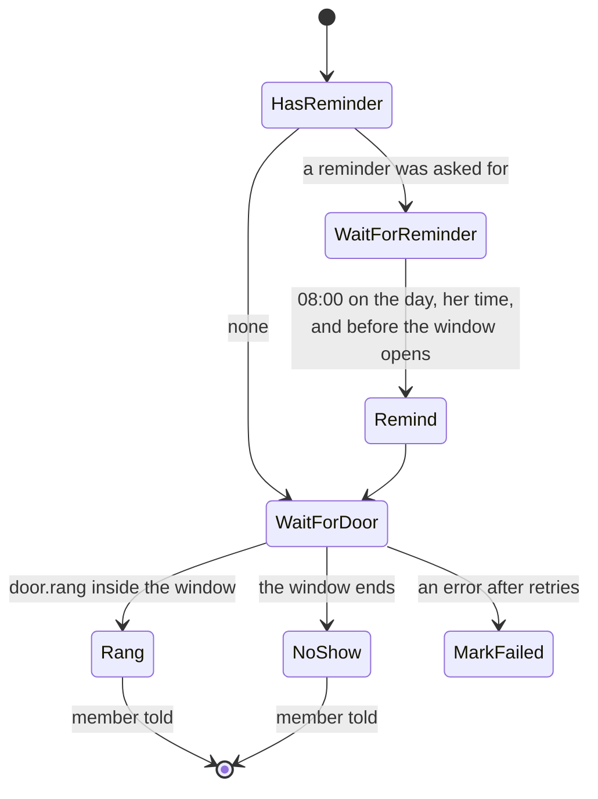

- **`arrange_visit`** `{ who, date, time, reminder, tellMe }`. In one DynamoDB transaction it writes the errand (`ERRAND#<id>`) and a roster entry for the visitor (`PER#errand:<id>`, the expected moment ±60 minutes, filed under the member). Then it starts the state machine, named after the errand so a retry starts nothing twice. `who` must clear the Guardian: the errand's words reach the family again. One narrow exception (`clearVisitorForFamily`, `services/policy`): a general clinician's title — the doctor, Dr Rossi, the district nurse, the GP — is who comes to help, like a carer, and is taken; a title that says what for (a psychiatrist, a therapist) and any other protected word are still refused, and the lexicon is unchanged, so the door camera's sentences still never say "a nurse". Those words are handed back whole only to the member who wrote them; anyone else reading the door or the day gets the sentence without the name. Limits: 2 minutes to 60 days ahead, ten open errands per home.
- **The door.** Every press of the bell, real or stand-in, puts a `door.rang` event on the Wick bus after the card is made (best effort: it never delays the card). A person seen at the door who did not ring gets her card but is not a ring. The `errand-door` Lambda finds the home's errand waiting on that window and wakes the workflow (`SendTaskSuccess`). The card itself says the visitor is expected around now, through the roster, and adds "Sarah arranged a visit for about now." — never that this ring is them: a ring in the window may be anyone, so "Ask Sarah to look" stays on the card.
- **The reminder** is a note from the member, written by code from the phrasebook, in her language, DEFERRED: it waits for a natural break like any other note.
- **The member is told** by Web Push (no names, no times in the payload) and sees the outcome in the family app: "Someone rang at 10:04, around when the plumber was expected", never "the plumber came". Whether it was the plumber is hers to say (M5).
- **Every step asks again** whether the member is still allowed (INV-9). If not, the errand closes quietly and the roster entry goes.
- `get_errands` and `cancel_errand` (only the author may cancel) complete the set. **26 MCP tools** in all.
- **For judges**: arrange a visit five minutes ahead in a demo home, then ring the stand-in doorbell's "The visitor you arranged".

### 19.1 The visit pass

*In short: the visitor Sarah arranged says from their own phone that they are on the way, running late, or at the door. A ring within ten minutes of "I'm at the door" is the first ring Wick can say is them.*

From a real conversation (README, *A real door*): a different doctor each time, nobody she recognises, a door kept shut, and a telephone call to her daughter in Italy. An expected stranger and an unknown stranger look the same at her door; the door alone can say who is due, never who has come. The pass is the evidence that was missing — a link Wick handed the member, pressed on the step. No model decides it and no face is kept.

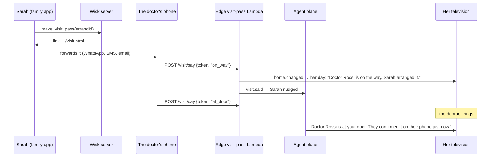

- **`make_visit_pass`** `{ errandId }`, the errand's author only, while it is open. 128 random bits as 32 hex characters; only the SHA-256 is stored (`VPASS#<hash>`), with the household and the errand. A new pass replaces the old one. The link is the family app's `/visit.html#<token>`: after `#`, so the token is in no server's log.
- **The page** has three buttons and nothing about the house: no name, no address, no household. It opens three hours before the visit and closes when the window does. Every refusal — an unknown link, a visit called off, a member she no longer allows, a window past — answers the same `over`, so the page is no oracle. Thirty presses per pass, and the routes have their own API Gateway limits.
- **What a press does** (`services/edge-device/lambda/visit-pass.mjs`): what was said is kept on the errand and its roster entry, her home screen is told (`home.changed`), and `visit.said` goes on the bus for the agent plane, which nudges the member (`visitor_on_way`, `visitor_late`, `visitor_at_door`: a kind, no words) and, when the ring came first, puts the confirmation on the door card already up.
- **The door** (`services/agent/src/agents/door`): a ring matched to an arranged visit reads that visit's last word fresh. Within ten minutes either side of "I'm at the door", the card says who is there and how Wick knows. Without it, the card is exactly as before — who is due, "Ask Sarah to look". A ring when nobody at all is expected says so: *"Nobody is expected at the door now. You don't have to open."*
- **Never** "you can open" or "it is safe": the card states what Wick knows and the door is hers. A forwarded link is the member's choice; the pass proves only that whoever pressed holds it.
- **For judges**: in a demo home, arrange "the doctor in five minutes", press *Send a link to the doctor*, open the link in another tab, press *I'm at the door*, then ring the stand-in doorbell's "The visitor you arranged".

## 20. THE GUARDRAIL

*In short: a Bedrock Guardrail is a second, model-side check on both agents. The Guardian stays the gate of record.*

`infra/guardrail.tf`: denied topics (medical advice, financial advice, guessing her mood), content filters at HIGH, phone numbers, emails and addresses anonymised, and contextual grounding at 0.5 with no relevance filter, published as a fixed version that changes whenever the guardrail does. Both agents apply it (`ApplyGuardrail`) to what they *say*, never to what they are asked: the Sunday brief to its paragraph and suggestion, grounded in the week's counted facts; the assistant to its reply, grounded in the tools' own texts. A sentence the facts do not support is refused, and so is any guess about how she feels. Either check, the Guardian or the Guardrail, may refuse.

Two things measured on the deployed guardrail decided this (FL-048). Attached to the model, the guardrail read the member's question too, and its "guessing her mood" topic refused "How has my mum been this week?", the question Wick exists to answer. And the grounding threshold had to be measured, not assumed: faithful paraphrases of a week's facts scored 0.68 to 1.00, every sentence adding something the facts did not say scored 0.00 to 0.04, and at the first threshold, 0.75, honest paragraphs were refused. The relevance filter went for the same reason. Wick answers "How has my mum been?" with what the house saw, never with how she feels, and relevance scored those honest answers 0.07 to 0.15, and plain factual suggestion reasons near 0. At 0.5 it refused nearly every true answer, and it refused nothing that grounding let through. Last, the tools answer in JSON, with moments in epoch milliseconds, so a true reply that named a day ("on Tuesday", "the week of 5 October") scored 0.08 to 0.34. The assistant now grounds on a copy with each moment written as the day, date and time at the house (`assistant/grounding.ts`), and the same replies score 0.93 to 0.97. Grounding still does not check which person came on which day ("Maria visited on Monday", when only the door rang that day, scored 0.96). It does catch a wrong count and a day with nothing on it.

## 21. THE SUNDAY BRIEF

*In short: each home's week is written by a Strands Graph on AgentCore — counted by code, written by a model, checked twice — and ends with one thing the family member could do, chosen from a fixed menu and checked by code.*

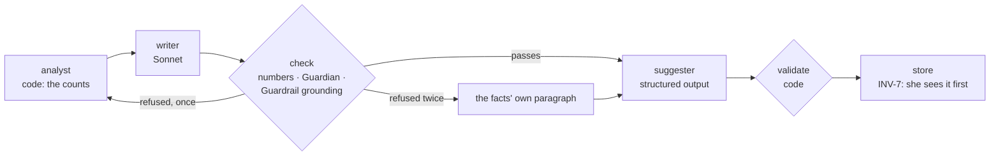

- **Fan-out.** Sunday's rule starts `brief-dispatch`, which queues one message per home with a television (SQS, with a dead-letter queue and an alarm). `brief-worker` invokes the runtime (`brief.weekly`) for one home at a time, two at once at most. If the runtime fails, it falls back to the Narrator for that home, so a week is always written. This also removes the Narrator's limit of one 15-minute run for every home.
- **The suggestion** (`packages/contracts/src/brief.ts`) is one of `send_note`, `arrange_visit`, `watch_together` or `nothing`, with a reason of at most 140 characters. Code decides whether it may stand: `arrange_visit` only if a usual visitor came less than usual, `watch_together` only if a film was played that week. The reason passes the number check, the Guardian and the Guardrail. Anything else becomes `nothing`.
- **Delivery.** She sees her week first, as before (INV-7). The first time she opens it on her television, the edge puts `week.seen` on the bus and the family members with notifications on get a `week_ready` push. The family app's week card then shows "One thing you could do" with one button: write a note, arrange a visit, or invite her to a film.
- **Demo homes** get their newest week rewritten by the agents when the home is made, so a judge sees an agents' week with a suggestion.

---

## APPENDIX A — Verified Vega identifiers

All ✅ V from `AmazonAppDev/vega-video-sample/manifest.toml`. This is the research list; Wick's own manifest is `apps/tv-vega/manifest.toml`.

- **Runtime module:** `/com.amazon.kepler.runtime.react_native_kepler_4@IReactNativeKepler_0`
- **Services:** `com.amazon.tv.developer.dataservice` · `com.amazon.media.server` · `com.amazon.media.playersession.service` · `com.amazon.mediatransform.service` · `com.amazon.audio.stream` · `com.amazon.network.service` · `com.amazon.inputd.service`
- **Privileges:** `com.amazon.tv.content-personalization.privilege.provide-data` · `com.amazon.devconf.privilege.accessibility`
- **Interfaces:** `IContentPersonalizationServer` · `IMediaPlaybackServer` · `IContentLauncherServer` and `IAccountLoginServer` (partner-gated)
- **Headless:** `registerHeadlessEntryPoint` for tasks; `registerHeadlessEntryPoint2` for services

## APPENDIX B — Ring Partner API cheat sheet ✅ V

```
Auth      OAuth 2.0 + PKCE (S256) · access ~4h · refresh ~30d
Devices   GET  /v1/devices[?include=status,capabilities,location,configurations]
Live      POST /v1/devices/{id}/media/streaming/whep/sessions   (application/sdp)
Media     POST /v1/devices/{id}/media/image/download            (303 -> JPEG, recorded, ~3.2 s)
Chime     POST /v1/devices/{id}/media/audio/playback
History   GET  /v1/history/devices/{id}/events
Webhooks  X-Signature: sha256=<hex HMAC of raw body> · ACK within 5 s
          v1.1 envelope · idempotency on meta.request_id
          4xx not retried · 5xx retried 1 s to 1 h, then dead-lettered 72 h
Limits    100 rps · server to server only
Absent    two-way audio · siren · lights · signed timestamp · event sandbox
```

## APPENDIX C (removed)

The wearable cheat sheet was removed with its connector (§7.2).

## APPENDIX D — Alexa+ add-on cheat sheet ✅ V

```
Spec      MCP 2025-11-25 · Streamable HTTP
Latency   round trip < 500 ms (§9.3)
Auth      OAuth 2.1 + PKCE · 401 without WWW-Authenticate · resource = server URI
Tools     discovered at deploy time; redeploy after any change
Manifest  addon-package/addon.json · name ≤30 · short ≤123 · full ≤4000
          3–4 example phrases · live privacy and terms URLs · six icon sizes
Region    US only
Access    partner-gated (FL-001)
```

## APPENDIX E — Friction

Every platform gap found while building is in [`FRICTION.md`](../FRICTION.md), written when it was hit.

---

*Wick technical document · version 3.0 · 16 October 2026*
